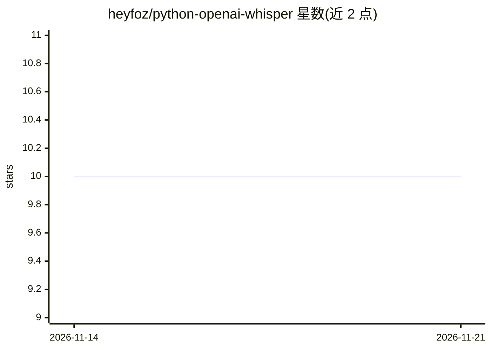

# heyfoz/python-openai-whisper

⭐ 10 · Python · MIT · 推送 2025-12-03 · [GitHub](https://github.com/heyfoz/python-openai-whisper) · 个人维护

**调用 OpenAI Whisper API 转写音频的 Python 脚本**

一个 Python 脚本，通过 OpenAI API 的语音转文字功能（由 Whisper 模型驱动）转写音频文件，结果以文本或 VTT（WebVTT）格式输出到控制台。使用方式为交互式：运行脚本后按提示输入音频文件路径并选择输出格式。依赖 OpenAI Python 客户端库，需自备 API key，文件大小上限为 25 MB。

## 筛选速览

| 维度 | 判定 | 备注 |
|---|---|---|
| AI 角色 | `ai-native` | 本体是模型或模型工具 |
| 许可风险 | `permissive` | MIT |
| 部署形态 | `library` | 以包/库形式分发 |
| 模型依赖 | — | README 未给出锁定关系 |
| 硬件要求 | — | 无带数字的原话,不猜 |
| 安装摩擦 | `low` | 无编译、无系统依赖或容器化 |
| 成熟度 | — | 结构信号不足 |

## 能力要点

- 调用 OpenAI API 的 speech-to-text 功能转写音频
- 支持文本与 VTT（WebVTT）两种输出格式
- 交互式命令行，按提示输入文件路径与格式

## 适用场景

- 把录音文件转写成文字
- 为视频生成 VTT 字幕文件

## 场景标签

`语音识别` · 领域:感知与多模态

## 证据(README 行号)

> L3: This Python script provides a simple interface to transcribe audio files using the OpenAI API's speech-to-text funct
> L33: Follow the prompts to enter the file path of the audio file and choose the desired response format (text or vtt).

## 星数曲线

2026-11-14 10 → 2026-11-21 10（+0）

---
*卡片 v1 · prompt 1.4 · 生成 2026-11-19 · 置信度 mid · 依据 README sha `77bd3c50503d` · [字段定义](../../DATASET.md)*
