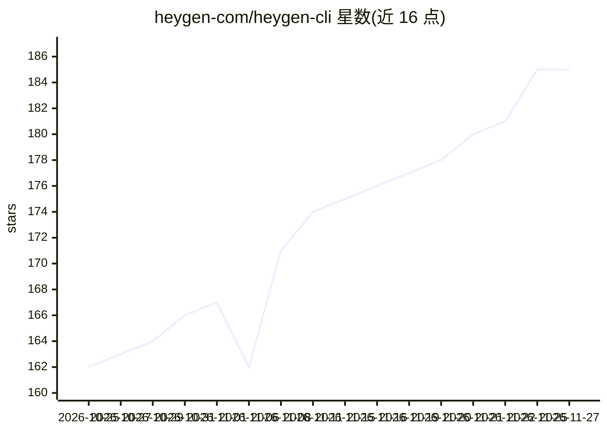

# heygen-com/heygen-cli

⭐ 185 · Go · Apache-2.0 · 推送 2026-11-26 · [GitHub](https://github.com/heygen-com/heygen-cli) · [官网](https://developers.heygen.com) · 组织维护

**开发者用 HeyGen API 在终端生成/翻译 AI 视频的官方 CLI**

HeyGen 视频生成 API 的官方命令行客户端，以 Go 编写的单一静态二进制分发，命令与 HeyGen v3 API 对应：文本生成视频、模板/头像/语音管理、语音克隆、视频翻译、口型同步、素材上传等。面向 coding agents、CI/CD 流水线与批量操作设计：stdout 固定输出 JSON、stderr 输出结构化错误、退出码稳定、默认非交互，并提供 schema 自描述命令与面向 agent 的技能安装包。使用需 HeyGen API key 或 OAuth 凭证；Windows 仅经 WSL 支持。

## 筛选速览

| 维度 | 判定 | 备注 |
|---|---|---|
| AI 角色 | `ai-ecosystem` | LLM/agent 周边工具 |
| 许可风险 | `permissive` | Apache-2.0 |
| 部署形态 | `None` |  |
| 模型依赖 | — | README 未给出锁定关系 |
| 硬件要求 | — | 无带数字的原话,不猜 |
| 安装摩擦 | `low` | 无编译、无系统依赖或容器化 |
| 成熟度 | — | 结构信号不足 |

## 能力要点

- 命令镜像 HeyGen v3 API：video-agent、template、avatar、voice、video-translate、lipsync 等 12 组
- Agent 优先设计：JSON stdout、结构化错误、稳定退出码、--request-schema/--response-schema 免鉴权自描述
- 单一静态二进制，无运行时依赖，安装到 ~/.local/bin
- 提供 Claude Code/Codex 等 agent 的一行式技能安装（heygen-com/skills）

## 适用场景

- 在 shell 循环中批量翻译上百条视频
- CI/CD 流水线自动生成发布说明视频
- 让 Claude Code 等 agent 在对话中直接创建 avatar 视频
- 在自有工具中包装 HeyGen API 做定制集成

## 场景标签

`视频生成` · 领域:内容生成

## 证据(README 行号)

> L7: **Make AI videos from the command line.** Drive HeyGen with code, not clicks.
> L151: Mirrors the HeyGen v3 API. Pattern: `heygen <noun> <verb>`.
> L26: - **JSON on stdout, structured errors on stderr, stable exit codes.**

## 星数曲线

2026-10-25 162 → 2026-11-27 185（+23）

---
*卡片 v1 · prompt 1.4 · 生成 2026-11-26 · 置信度 high · 依据 README sha `8350d9e58891` · [字段定义](../../DATASET.md)*
