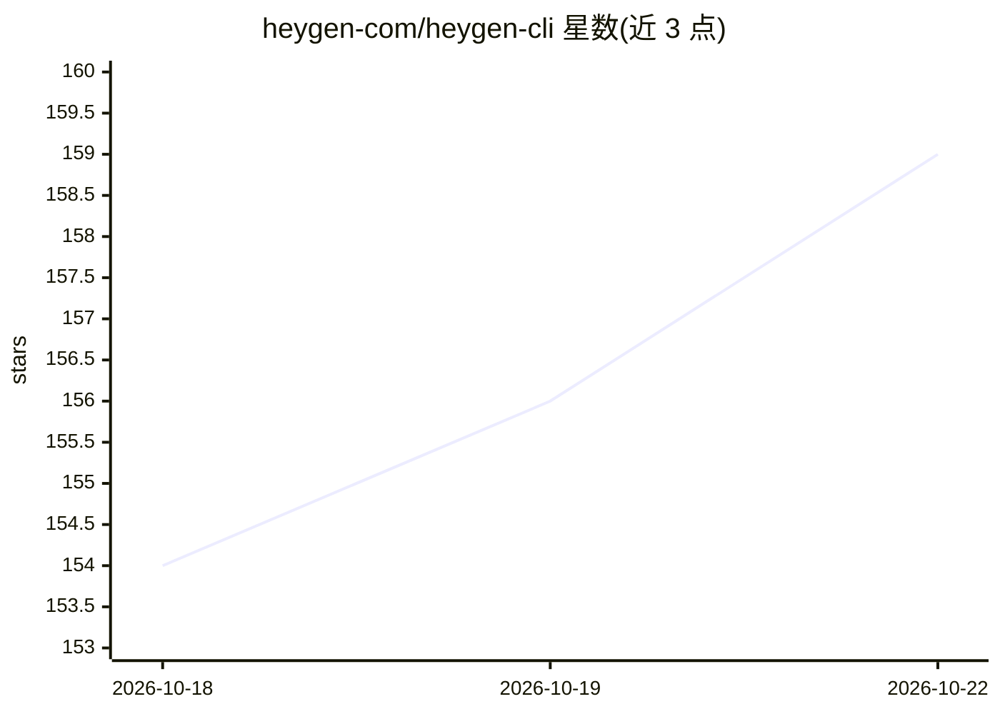

# heygen-com/heygen-cli

⭐ 159 · Go · Apache-2.0 · 推送 2026-10-21 · [GitHub](https://github.com/heygen-com/heygen-cli) · [官网](https://developers.heygen.com) · 组织维护

**HeyGen 官方命令行工具：终端中创建 AI 数字人视频**

HeyGen 视频生成 API 的官方 CLI，Go 编写的单一静态二进制，覆盖 macOS/Linux/Windows(WSL)。面向编码代理（Claude Code、Codex）、CI/CD 管道与批量操作设计：stdout 恒为 JSON、结构化错误信封、稳定退出码、--request-schema 自描述、默认非交互。命令镜像 HeyGen v3 API，支持文本生成视频、模板、数字人/声音管理、语音克隆、视频翻译、口型同步、webhook 等多种操作。认证支持 API key 环境变量、管道登录、OAuth 等六种方式；需 HeyGen 账户 API key。

## 筛选速览

| 维度 | 判定 | 备注 |
|---|---|---|
| AI 角色 | `ai-ecosystem` | LLM/agent 周边工具 |
| 许可风险 | `permissive` | Apache-2.0 |
| 部署形态 | `None` |  |
| 模型依赖 | — | README 未给出锁定关系 |
| 硬件要求 | — | 无带数字的原话,不猜 |
| 安装摩擦 | `low` | 无编译、无系统依赖或容器化 |
| 成熟度 | — | 结构信号不足 |

## 能力要点

- 命令覆盖视频生成/模板/数字人/声音克隆/视频翻译/口型同步等 HeyGen v3 API
- 面向代理与 CI 设计：stdout 恒为 JSON、结构化错误、稳定退出码、自描述 schema
- curl 安装脚本装单一静态二进制，无需运行时依赖
- 提供 heygen-com/skills 一行安装的代理技能包

## 适用场景

- 在 CI/CD 中自动生成周报视频或版本发布视频
- 用 shell 循环批量翻译或生成上百个视频
- 让 Claude Code 等编码代理通过技能包在对话中生成视频

## 场景标签

`视频生成` · 领域:内容生成

## 证据(README 行号)

> L7: **Make AI videos from the command line.** Drive HeyGen with code, not clicks.
> L11: Full reference and examples: **developers.heygen.com/cli**.
> L26: - **JSON on stdout, structured errors on stderr, stable exit codes.**

## 星数曲线

2026-10-18 154 → 2026-10-22 159（+5）

---
*卡片 v1 · prompt 1.4 · 生成 2026-10-22 · 置信度 high · 依据 README sha `1c3f644693e6` · [字段定义](../../DATASET.md)*
