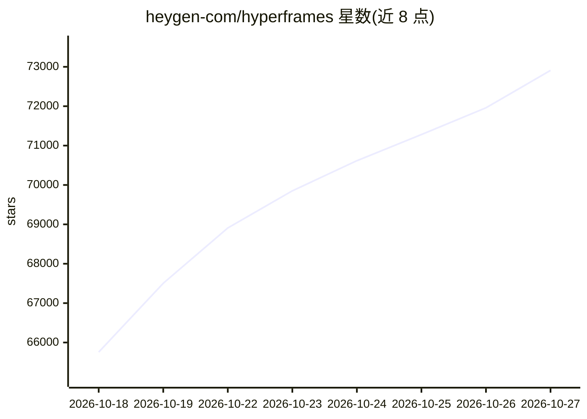

# heygen-com/hyperframes

⭐ 72,909 · TypeScript · Apache-2.0 · 推送 2026-10-26 · [GitHub](https://github.com/heygen-com/hyperframes) · [官网](https://hyperframes.heygen.com) · 组织维护

**给开发者和 AI 编码代理：把 HTML/CSS/动画渲染为确定性 MP4 视频**

一个将 HTML、CSS、媒体与可寻址动画转为确定性 MP4 视频的开源框架，支持三种使用方式：本地 CLI、面向 AI 编码代理的 skills（21 个，含路由器与按需加载的领域技能）、以及作为托管创作流程的渲染核心。代理工作流覆盖产品介绍视频、PR 讲解、字幕嵌入、动效图形、幻灯片等 9 类创作流程；运行时适配 GSAP、Lottie、Three.js、Anime.js、CSS、WAAPI。要求 Node.js 22+ 与 FFmpeg。

## 筛选速览

| 维度 | 判定 | 备注 |
|---|---|---|
| AI 角色 | `ai-ecosystem` | LLM/agent 周边工具 |
| 许可风险 | `permissive` | Apache-2.0 |
| 部署形态 | `library` | 以包/库形式分发 |
| 模型依赖 | — | README 未给出锁定关系 |
| 硬件要求 | — | 无带数字的原话,不猜 |
| 安装摩擦 | `medium` | 含编译或系统依赖之一 |
| 成熟度 | — | 结构信号不足 |

## 动量与使用信号

- 维护:`active` — 距上次 push 0.6 天,年发版 100,101 位贡献者
- 涨星:近 1 天 **+994**(自 20261016 起算)
- 安装:npm 包 `skills` 月下载 23,786,800
- 平台:LINUX · 协议:MCP

## 能力要点

- 把定义为 HTML 的视频按 data-* 时间属性渲染为确定性 MP4
- 提供 21 个 agent skills，含 `/hyperframes` 意图路由与按需加载的领域技能
- 支持 Claude Code、Codex、Cursor、Gemini CLI 等支持 skills 的编码代理
- 支持 GSAP/CSS/Lottie/Three.js/Anime.js/WAAPI 等可寻址动画运行时

## 适用场景

- 用 AI 编码代理从产品 URL 或简介生成发布介绍视频
- 把 GitHub PR 渲染成带动画代码差异的讲解视频
- 制作带动态字幕与音乐的社交媒体视频
- 把现有 Remotion 组合迁移到 HyperFrames HTML

## 场景标签

`视频生成` · 领域:内容生成

## 证据(README 行号)

> L21: HyperFrames is an open-source framework for turning HTML, CSS, media, and seekable animations into deterministic MP
> L44: > The picker opens with nothing pre-selected — the **Core Skills** group is all you need: the `/hyperframes` router
> L52: The skills teach agents the HyperFrames production loop: plan the video, write valid HTML, wire seekable animations

## 星数曲线

2026-10-18 65,757 → 2026-10-27 72,909（+7,152）

---
*卡片 v1 · prompt 1.4 · 生成 2026-10-18 · 置信度 high · 依据 README sha `84470d51b750` · [字段定义](../../DATASET.md)*
