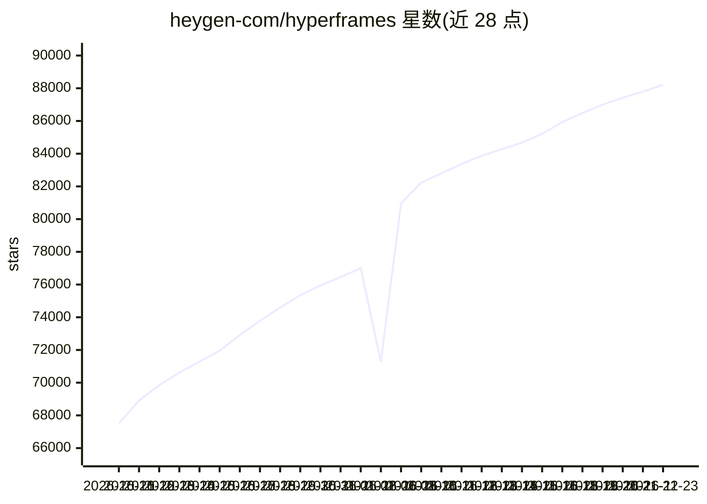

# heygen-com/hyperframes

⭐ 88,218 · TypeScript · Apache-2.0 · 推送 2026-11-22 · [GitHub](https://github.com/heygen-com/hyperframes) · [官网](https://hyperframes.heygen.com) · 组织维护

**开源 AI 视频编辑框架：描述或重制视频生成可逐帧编辑的项目**

HeyGen 开源的 HTML/CSS/JavaScript 转确定性 MP4 的视频框架与编辑器（Apache 2.0）。用户描述视频、带入素材或重制已有视频，得到可编辑项目，通过打字或指点让 agent 修改指定元素。三种使用方式：Studio 桌面应用（免费计划，Pro 每月 25 美元含视频/图像/语音/音乐模型与 25,000 credits）、编码 agent 技能（Claude Code/Codex/Cursor 等）、聊天连接器。要求 Node.js 22+ 与 FFmpeg，支持云渲染与 AWS Lambda。

## 筛选速览

| 维度 | 判定 | 备注 |
|---|---|---|
| AI 角色 | `ai-ecosystem` | LLM/agent 周边工具 |
| 许可风险 | `permissive` | Apache-2.0 |
| 部署形态 | `library` | 以包/库形式分发 |
| 模型依赖 | — | README 未给出锁定关系 |
| 硬件要求 | — | 无带数字的原话,不猜 |
| 安装摩擦 | `medium` | 含编译或系统依赖之一 |
| 成熟度 | — | 结构信号不足 |

## 动量与使用信号

- 维护:`active` — 距上次 push 0.6 天,年发版 100,101 位贡献者
- 涨星:近 1 天 **+994**(自 20261016 起算)
- 安装:npm 包 `skills` 月下载 23,786,800
- 平台:LINUX · 协议:MCP

## 能力要点

- HTML/CSS/JS 与可跳转动画确定性渲染为 MP4，无需 React
- 9 个 skills 教 agent 完成规划、写 HTML、lint、预览、渲染的生产循环
- 约 450 个可编辑源码的现成组件块（转场、字幕、图表、地图、3D）
- 支持本地 CLI、云渲染与 AWS Lambda 三种渲染途径

## 适用场景

- 从手机素材生成带字幕、音乐、文字钩子的社交短视频
- 从网站 URL 或录屏生成产品演示与教程视频
- 用代码生成运动图形并接入自动化内容流水线
- 逐帧重制已有视频为可编辑项目

## 场景标签

`视频生成` · 领域:内容生成

## 证据(README 行号)

> L26: HyperFrames is HeyGen's AI video editor for people and agents. Describe a video, bring your own footage, or remake 
> L28: Underneath, HyperFrames is a free, open-source framework (Apache 2.0) for turning HTML, CSS, JavaScript, media and 
> L35: |**Your coding agent**|Claude Code, Codex, Cursor, Gemini CLI and other agents.|`npx skills add heygen-com/hyperfra

## 星数曲线

2026-10-21 67,504 → 2026-11-23 88,218（+20,714）

---
*卡片 v1 · prompt 1.4 · 生成 2026-11-23 · 置信度 high · 依据 README sha `11d3d2bbd4e4` · [字段定义](../../DATASET.md)*
