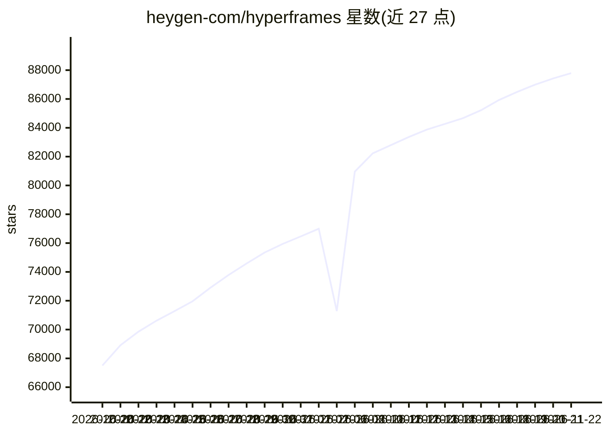

# heygen-com/hyperframes

⭐ 87,795 · TypeScript · Apache-2.0 · 推送 2026-11-21 · [GitHub](https://github.com/heygen-com/hyperframes) · [官网](https://hyperframes.heygen.com) · 组织维护

**面向 AI agent 的开源 HTML 转 MP4 视频框架与编辑器**

开源框架，把 HTML、CSS、媒体与可寻址动画确定性地渲染为 MP4：合成即 HTML 文件加 data 属性，渲染器在 headless Chrome 中逐帧 seek 并用 FFmpeg 编码，同输入产出同视频。主要使用路径是配合 Claude Code、Codex、Cursor 等编码 agent 安装 9 个技能后用自然语言出片；也可不经 agent，直接用 CLI 执行 init/preview/render。附约 450 个组件目录、frame.md 设计系统转换层，并提供 Mac/Win/Linux 桌面版 Studio（Pro 订阅提供 HeyGen 模型）。要求 Node.js 22+ 与 FFmpeg。

## 筛选速览

| 维度 | 判定 | 备注 |
|---|---|---|
| AI 角色 | `ai-enhanced` | 去掉 AI 部分产品仍成立 |
| 许可风险 | `permissive` | Apache-2.0 |
| 部署形态 | `library` | 以包/库形式分发 |
| 模型依赖 | — | README 未给出锁定关系 |
| 硬件要求 | — | 无带数字的原话,不猜 |
| 安装摩擦 | `medium` | 含编译或系统依赖之一 |
| 成熟度 | — | 结构信号不足 |

## 动量与使用信号

- 维护:`active` — 距上次 push 0.6 天,年发版 100,101 位贡献者
- 涨星:近 1 天 **+994**(自 20261016 起算)
- 安装:npm 包 `skills` 月下载 23,786,800
- 平台:LINUX · 协议:MCP

## 能力要点

- HTML 合成经 headless Chrome 逐帧 seek + FFmpeg 编码为确定性 MP4
- 9 个 agent 技能教编码 agent 完整视频生产流程（lint/预览/渲染）
- 约 450 个可编辑源码形式的 blocks/components 目录
- 支持本地、Docker、AWS Lambda 三种渲染部署方式

## 适用场景

- 让编码 agent 用自然语言生成可逐帧修改的视频项目
- 数据可视化、动态字幕、产品介绍等动效视频的自动化渲染
- 把已有设计系统（frame.md）转成视频可用的设计规范
- 把任意已有视频反向重建为可编辑的 HTML 项目

## 场景标签

`视频生成` · 领域:内容生成

## 证据(README 行号)

> L28: HyperFrames is a free, open-source framework for turning HTML, CSS, media, and seekable animations into determinist
> L117: ### Manually with the CLI
> L190: Preview instantly in the browser. Render locally or in Docker. The renderer seeks each frame in headless Chrome an

## 星数曲线

2026-10-20 67,504 → 2026-11-22 87,795（+20,291）

---
*卡片 v1 · prompt 1.4 · 生成 2026-11-22 · 置信度 high · 依据 README sha `ff1ca8c6ba30` · [字段定义](../../DATASET.md)*
