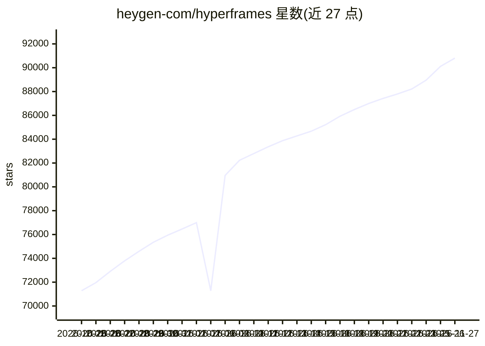

# heygen-com/hyperframes

⭐ 90,804 · TypeScript · Apache-2.0 · 推送 2026-11-26 · [GitHub](https://github.com/heygen-com/hyperframes) · [官网](https://hyperframes.heygen.com) · 组织维护

**面向人与 AI agent 的开源视频编辑框架：写 HTML 渲染 MP4**

HeyGen 开源的框架与配套应用：把 HTML、CSS、JavaScript、媒体与可 seek 的动画确定性地渲染为 MP4。提供三种使用方式：免费的 Studio 桌面应用（描述需求或导入素材后由 agent 编辑）、为 Claude Code/Codex/Cursor 等 coding agent 安装的 9 个 skills、以及本地 CLI（init/preview/render）。核心框架 Apache 2.0；Studio 有免费计划，Pro 订阅（$25/月）提供视频、语音、音乐模型与 25,000 月度积分。支持云端渲染与 AWS Lambda。

## 筛选速览

| 维度 | 判定 | 备注 |
|---|---|---|
| AI 角色 | `ai-ecosystem` | LLM/agent 周边工具 |
| 许可风险 | `permissive` | Apache-2.0 |
| 部署形态 | `library` | 以包/库形式分发 |
| 模型依赖 | — | README 未给出锁定关系 |
| 硬件要求 | — | 无带数字的原话,不猜 |
| 安装摩擦 | `medium` | 含编译或系统依赖之一 |
| 成熟度 | — | 结构信号不足 |

## 动量与使用信号

- 维护:`active` — 距上次 push 0.6 天,年发版 100,101 位贡献者
- 涨星:近 1 天 **+994**(自 20261016 起算)
- 安装:npm 包 `skills` 月下载 23,786,800
- 平台:LINUX · 协议:MCP

## 能力要点

- HTML/CSS/JS 到 MP4 的确定性渲染框架（Apache 2.0，无 React 要求）
- 为 Claude Code、Codex、Cursor 等 agent 提供的 9 个 skills 及约 450 个可编辑组件目录
- CLI 本地渲染、hyperframes cloud render 云渲染与 AWS Lambda 渲染
- Studio 应用支持脚本化编辑、字幕、改词定位帧级修改

## 适用场景

- 用自然语言描述或导入素材生成产品介绍与社媒视频
- 让 coding agent 按需求生成并渲染动效视频
- 把任意视频重建为可逐帧编辑的 HyperFrames 项目
- 用代码替代 After Effects 制作可流水线复用的动效

## 场景标签

`视频生成` · 领域:内容生成

## 证据(README 行号)

> L26: HyperFrames is HeyGen's AI video editor for people and agents. Describe a video, bring your own footage, or remake 
> L28: Underneath, HyperFrames is a free, open-source framework (Apache 2.0) for turning HTML, CSS, JavaScript, media and 

## 星数曲线

2026-10-25 71,280 → 2026-11-27 90,804（+19,524）

---
*卡片 v1 · prompt 1.4 · 生成 2026-11-26 · 置信度 high · 依据 README sha `34488dbca948` · [字段定义](../../DATASET.md)*
