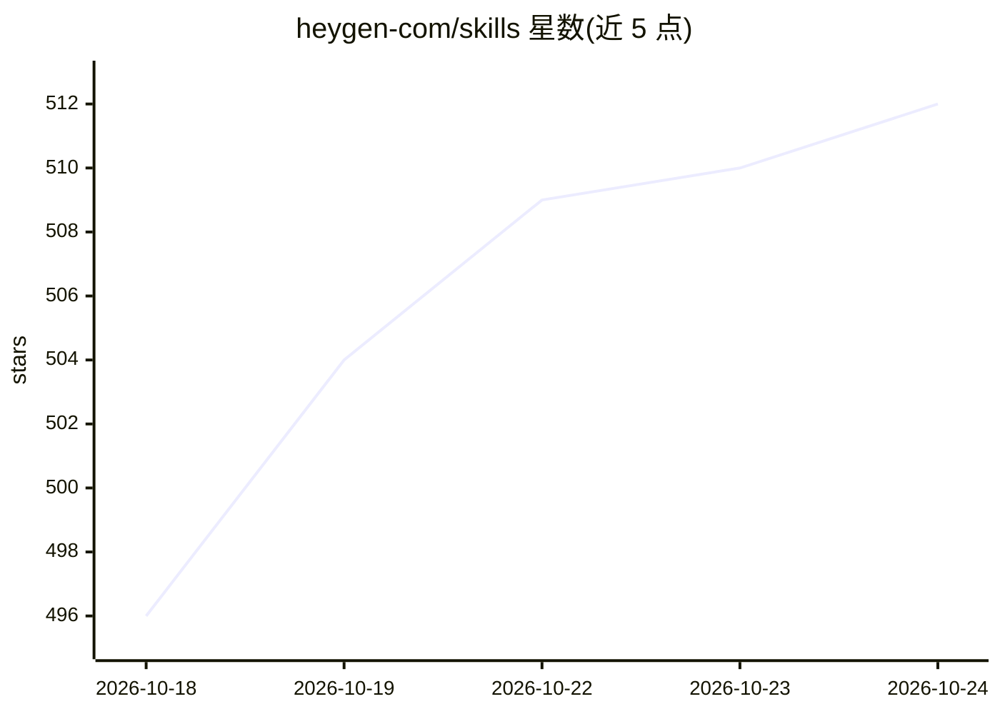

# heygen-com/skills

⭐ 512 · Shell · MIT · 推送 2026-07-14 · [GitHub](https://github.com/heygen-com/skills) · [官网](https://developers.heygen.com/docs/quick-start) · 组织维护

**让 AI agent 调用 HeyGen 生成数字人头像视频的技能包**

HeyGen 官方发布的三个 agent 技能（SKILL.md 格式）：heygen-avatar 将照片转为带声音的持久数字分身并保存 AVATAR 文件，heygen-video 据此撰写脚本并生成视频、返回分享链接，heygen-translate 对已有视频做 175+ 语言的翻译配音与口型同步。技能可安装到 Claude Code、OpenClaw、Codex、Cursor 等支持技能的 agent，通过 HeyGen CLI（API key）或远程 MCP（OAuth）调用，无运行时依赖。

## 筛选速览

| 维度 | 判定 | 备注 |
|---|---|---|
| AI 角色 | `ai-ecosystem` | LLM/agent 周边工具 |
| 许可风险 | `permissive` | MIT |
| 部署形态 | `None` |  |
| 模型依赖 | — | README 未给出锁定关系 |
| 硬件要求 | — | 无带数字的原话,不猜 |
| 安装摩擦 | `low` | 无编译、无系统依赖或容器化 |
| 成熟度 | — | 结构信号不足 |

## 能力要点

- 三个技能：头像创建、视频生成、视频翻译配音（175+ 语言）
- 通过 AVATAR-<NAME>.md 文件在技能间传递可复用的数字分身状态
- 双认证模式：HeyGen CLI（API key，优先）与远程 MCP（OAuth，走套餐额度）
- 支持 gh skill install / ClawHub / OpenClaw 插件 / git clone 四种安装方式

## 适用场景

- 让我的编程 agent 用一张照片创建自己的数字分身并生成自我介绍视频
- 把文章或 PDF 内容转成数字人讲解视频
- 为已完成的视频做多语言翻译配音

## 场景标签

`视频生成` · 领域:内容生成

## 证据(README 行号)

> L3: AI agent skills for creating avatar videos. Your agent gets a face, a voice, and the ability to send video like a me
> L160: The skills support two auth modes with explicit priority:
> L213: - An AI agent that supports skills (Claude Code, OpenClaw, Codex, Cursor, or similar)

## 星数曲线

2026-10-18 496 → 2026-10-24 512（+16）

---
*卡片 v1 · prompt 1.4 · 生成 2026-10-21 · 置信度 high · 依据 README sha `0b5086b4c9ba` · [字段定义](../../DATASET.md)*
