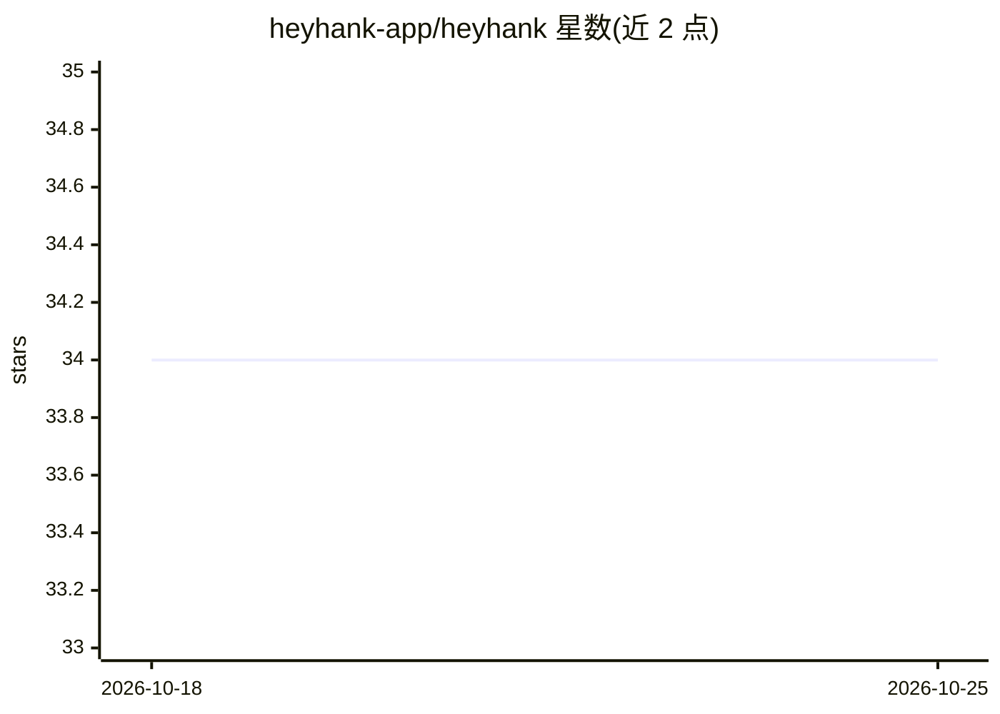

# heyhank-app/heyhank

⭐ 34 · TypeScript · MIT · 推送 2026-06-05 · [GitHub](https://github.com/heyhank-app/heyhank) · [官网](https://heyhank.app) · 个人维护

**自托管 Web UI：多会话运行 Claude Code/Codex agent**

基于 Bun + Hono 的自托管服务器，通过桥接 Claude Code CLI 的 --sdk-url WebSocket（NDJSON）将其转为浏览器可用的 WebSocket，提供多会话并行聊天、流式输出、工具调用可见性与权限控制；Codex CLI 为可选副后端。功能还包括技能市场（从 GitHub 来源安装 Claude Code 技能）、provider 无关聊天（Claude/Codex/Gemini/Ollama/OpenRouter）、本地语义记忆（vectra + transformers.js）、cron 定时 agent、Gemini 语音助手、Imagen/Veo 媒体生成、邮件/日历集成、FreeSWITCH 电话与社交媒体发布。通过 bunx 运行，可注册为 launchd/systemd 后台服务。

## 筛选速览

| 维度 | 判定 | 备注 |
|---|---|---|
| AI 角色 | `ai-ecosystem` | LLM/agent 周边工具 |
| 许可风险 | `permissive` | MIT |
| 部署形态 | `self-host` | docker 或自建部署 |
| 模型依赖 | local-ok | 支持本地模型 |
| 硬件要求 | — | 无带数字的原话,不猜 |
| 安装摩擦 | `low` | 无编译、无系统依赖或容器化 |
| 成熟度 | — | 结构信号不足 |

## 能力要点

- 多会话并行管理 Claude Code / Codex，含工具调用可见性与权限控制
- provider 无关聊天界面：Claude/Codex/Gemini/Ollama/OpenRouter
- 本地语义记忆：基于 vectra + transformers.js 的笔记与会话检索
- 语音助手、电话（FreeSWITCH SIP）、社交媒体发布、多实例 Federation

## 适用场景

- 在浏览器/手机上远程管理并运行多个 Claude Code agent 会话
- 通过语音或定时任务驱动 agent 完成任务
- 自托管一套个人助理：笔记、待办、邮件、日历一体化

## 场景标签

`编码 Agent` `AI 助手` `语音 Agent` `Agent 记忆` · 领域:Agent 开发

## 证据(README 行号)

> L4:  Self-hosted web UI for running Claude Code agents.
> L76: Claude Code CLI (primary)  /  Codex CLI (secondary)
> L79: The server bridges the CLI's `--sdk-url` WebSocket (NDJSON) to a browser-friendly WebSocket.

## 星数曲线

2026-10-18 34 → 2026-10-25 34（+0）

---
*卡片 v1 · prompt 1.4 · 生成 2026-10-25 · 置信度 mid · 依据 README sha `9b7628bbeb29` · [字段定义](../../DATASET.md)*
