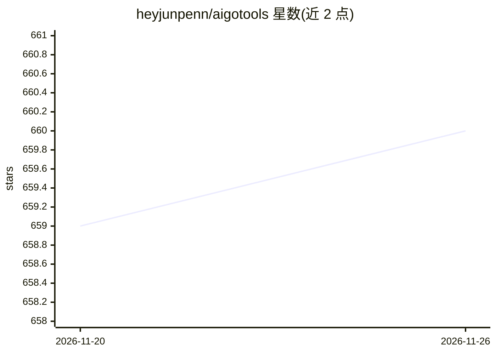

# heyjunpenn/aigotools

⭐ 660 · Astro · NOASSERTION · 推送 2026-11-19 · [GitHub](https://github.com/heyjunpenn/aigotools) · [官网](https://www.aigotools.com) · 个人维护 · 中文 README

**面向建站者的 AI 工具目录静态站：自带 221 条工具档案与 38 篇场景指南**

基于 Astro 的目录站点工程，内置 221 个已发布工具档案、38 篇场景指南和 547 张本地化图片资产，无需数据库、账号系统或 API key。构建时生成静态页面，浏览器端用 Pagefind 提供搜索索引，页面带 SEO 元数据、sitemap、robots.txt 与 llms.txt，并提供 SEO 检查脚本。内容通过 CLI 管理（修订、审批、发布），Git 跟踪文件变更；更新内容需重新构建。部署方式为上传 dist/ 到静态主机，仓库含 Cloudflare 配置示例。公共页面为英文，捆绑字体遵循自身许可，商标与品牌素材不在 MIT 授权范围内。

## 筛选速览

| 维度 | 判定 | 备注 |
|---|---|---|
| AI 角色 | `ai-knowledge` | 知识聚合/清单类 |
| 许可风险 | `none` | NOASSERTION |
| 部署形态 | `None` |  |
| 模型依赖 | — | README 未给出锁定关系 |
| 硬件要求 | — | 无带数字的原话,不猜 |
| 安装摩擦 | `low` | 无编译、无系统依赖或容器化 |
| 成熟度 | — | 结构信号不足 |

## 能力要点

- 内置 221 条工具档案与 38 篇场景指南，图片本地存储并经 SHA-256 校验
- 构建时生成静态页面，无需数据库、账号系统或 API key
- Pagefind 浏览器端搜索索引，无独立搜索服务或付费 API
- SEO 元数据、sitemap、robots.txt、llms.txt 生成与发布前 SEO 检查

## 适用场景

- 快速上线自己的 AI 工具导航目录站
- 按场景指南组织内容，引导读者按任务找工具
- 在无后端服务器的静态主机上部署并维护目录站

## 场景标签

`精选清单` `教程课程` · 领域:学习与行业

## 证据(README 行号)

> L9: An Astro directory for browsing AI tools and reading task-based guides. Includes the content library, local images a
> L19: The project includes 221 published tool profiles, 38 scenario guides and 547 image assets. Profiles and guides reta
> L27: Astro generates static pages at build time. The site runs without a database, account system or API keys. Upload `d

## 星数曲线

2026-11-20 659 → 2026-11-26 660（+1）

---
*卡片 v1 · prompt 1.4 · 生成 2026-11-20 · 置信度 high · 依据 README sha `6b9f790eaa0b` · [字段定义](../../DATASET.md)*
