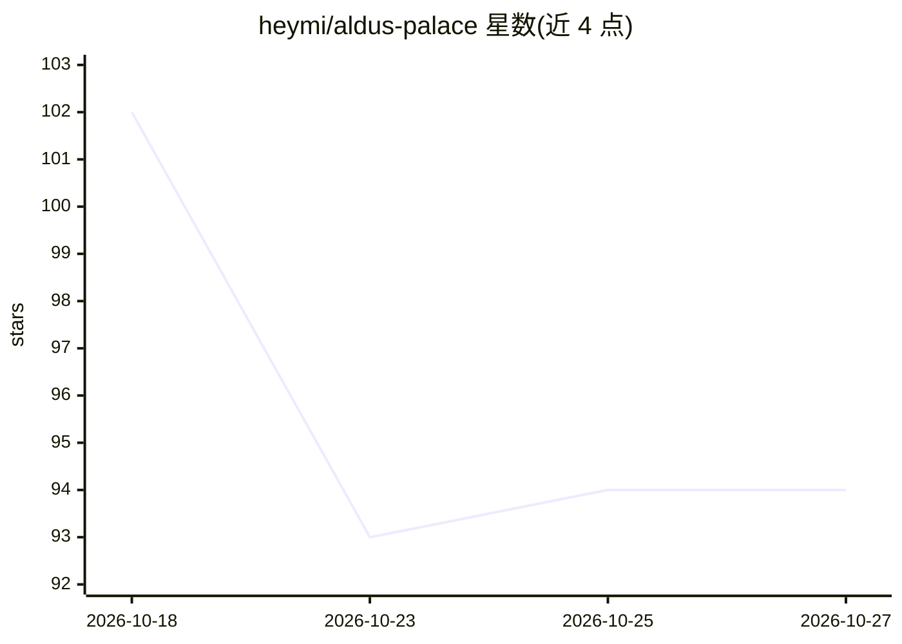

# heymi/aldus-palace

⭐ 94 · TypeScript · Apache-2.0 · 推送 2026-09-19 · [GitHub](https://github.com/heymi/aldus-palace) · 个人维护 · 中文 README

**面向 AI 助手的本地上下文层：自由文本变带证据的类型化承诺与记忆**

将自由文本句子解析为类型化对象（承诺、决策、思考、记忆候选），每条记录携带原始句子、置信度与是否由用户陈述的说明，存入用户自有的 SQLite 文件或 Cloudflare Durable Object。内含记忆管道（提取/冲突检测/版本化取代/全文检索）、规划引擎（四种时间类型、优先级评分、每日缓冲）与 Action Gate（高风险动作等待人工批准）。提供库、HTTP、MCP、类型化客户端四种接入面；离线确定性 provider 无需 API key 即可运行整条管道，接入模型后用于通用理解。面向构建 AI 产品的开发者、希望数据归属个人的用户与需审计 AI 数据的团队。

## 筛选速览

| 维度 | 判定 | 备注 |
|---|---|---|
| AI 角色 | `ai-ecosystem` | LLM/agent 周边工具 |
| 许可风险 | `permissive` | Apache-2.0 |
| 部署形态 | `self-host` | docker 或自建部署 |
| 模型依赖 | — | README 未给出锁定关系 |
| 硬件要求 | — | 无带数字的原话,不猜 |
| 安装摩擦 | `low` | 无编译、无系统依赖或容器化 |
| 成熟度 | — | 结构信号不足 |

## 能力要点

- 文本→类型化对象（承诺/决策/记忆），日期解析、去重、冲突检测
- Action Gate 分级自治：高风险等待批准，关键操作需两次确认
- 离线确定性 provider 运行完整管道，无需 API key
- 四种接入面（MCP/HTTP/库/类型化客户端）共用同一数据

## 适用场景

- 让 Claude/Cursor 等多个客户端共享同一份可携带的记忆与待办
- 为自己的 AI 产品提供带证据与可撤销的记忆层
- 需要审计 AI 生成记录来源的团队做可追溯存储

## 场景标签

`Agent 记忆` · 领域:Agent 开发

## 证据(README 行号)

> L70: |A developer building an AI product|A user writes a sentence; the system sorts it into a task, a decision or a pref
> L78: |**Text → typed objects**|A user writes a sentence and the product already has the task, the decision and the prefe
> L131: - **Four surfaces over the same data:** MCP, HTTP, the library and a typed

## 星数曲线

2026-10-18 102 → 2026-10-27 94（-8）

---
*卡片 v1 · prompt 1.4 · 生成 2026-10-23 · 置信度 mid · 依据 README sha `668474e18671` · [字段定义](../../DATASET.md)*
