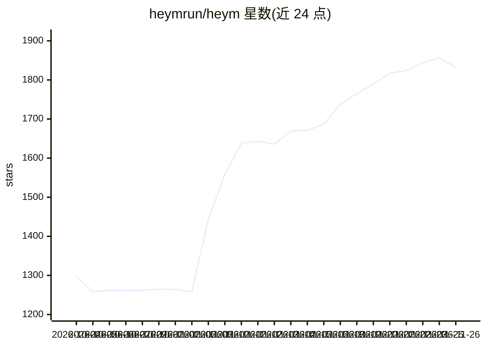

# heymrun/heym

⭐ 1,833 · Python · NOASSERTION · 推送 2026-11-25 · [GitHub](https://github.com/heymrun/heym) · [官网](https://heym.run) · 组织维护

**自托管 agentic 系统编排运行时平台：构建、运行、观测与人工控制**

自托管的 agent 系统运行时与平台，覆盖构建、编排、执行、观测、评估与控制全生命周期：通过可视化画布或 AI 助手生成由 agent、确定性节点、工具与数据组成的工作流图，运行时负责依赖与并行调度、执行历史记录与人工审核检查点；可观测模型请求、token、延迟与成本，支持跨模型 prompt 评测，并提供 REST/SSE/MCP 暴露方式。前置依赖 Bun、Python 3.11+、UV、Docker；许可为 MIT 附 Commons Clause 条款。

## 筛选速览

| 维度 | 判定 | 备注 |
|---|---|---|
| AI 角色 | `ai-ecosystem` | LLM/agent 周边工具 |
| 许可风险 | `permissive` | NOASSERTION |
| 部署形态 | `self-host` | docker 或自建部署 |
| 模型依赖 | — | README 未给出锁定关系 |
| 硬件要求 | — | 无带数字的原话,不猜 |
| 安装摩擦 | `low` | 无编译、无系统依赖或容器化 |
| 成熟度 | — | 结构信号不足 |

## 能力要点

- 多 agent 编排：orchestrator 可并发调用命名的 sub-agent 与子工作流
- RAG 知识检索支持 Qdrant 或 PostgreSQL/pgvector，并提供 per-agent 知识图谱
- 人工审核检查点：暂停 agent 执行，人工决策后从保存快照恢复
- 执行追踪与成本核算：token、延迟、USD 成本，可导出 OpenTelemetry

## 适用场景

- 在企业自有基础设施上部署并运维多 agent 业务流程
- 通过人工审核检查点保持对 agent 执行的控制
- 将工作流以 MCP 工具、REST 接口或聊天界面发布给应用与用户
- 对 prompt 与模型做跨模型评测并追踪运行成本

## 场景标签

`多智能体` `Agent 框架` `LLM 可观测性` `模型评测` · 领域:Agent 开发

## 证据(README 行号)

> L7:  Heym is a self-hosted runtime and platform for building, orchestrating, running, observing, evaluating, and control
> L36: In Heym, a workflow defines how agents, deterministic steps, tools, and data work together. The runtime executes th

## 星数曲线

2026-10-24 1,298 → 2026-11-26 1,833（+535）

---
*卡片 v1 · prompt 1.4 · 生成 2026-11-23 · 置信度 high · 依据 README sha `9e4c64172d83` · [字段定义](../../DATASET.md)*
