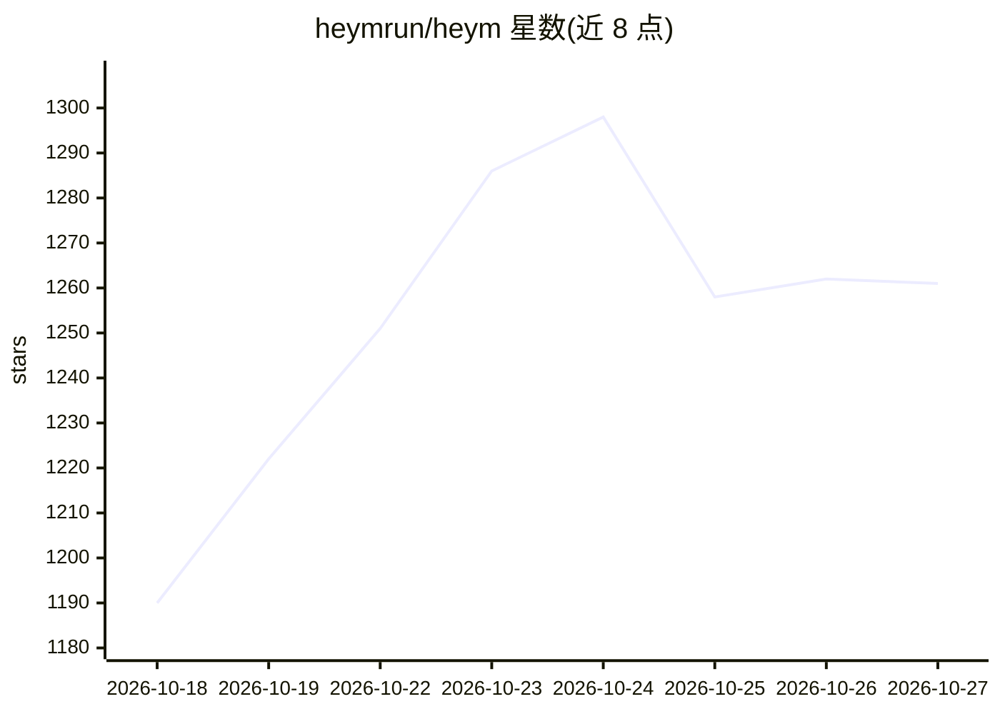

# heymrun/heym

⭐ 1,261 · Python · NOASSERTION · 推送 2026-10-26 · [GitHub](https://github.com/heymrun/heym) · [官网](https://heym.run) · 组织维护

**自托管的 agent 系统构建与运行平台，覆盖编排/评测/人审**

Heym 是自托管的 agentic 系统运行时与平台：通过可视化画布或 AI 助手构建 agent 与确定性工作流，支持多 agent 编排、并行执行、重试与人工审核检查点；运行时可记录执行历史、trace、token 与模型成本，提供提示词评测与跨模型对比。系统通过 REST、SSE、MCP 工具与 Portal 聊天界面对外暴露，内置 RAG（Qdrant/pgvector）、浏览器自动化与看板式 agent 任务。本地运行需 Bun、Python 3.11+、UV 与 Docker，许可为 MIT 加 Commons Clause。

## 筛选速览

| 维度 | 判定 | 备注 |
|---|---|---|
| AI 角色 | `ai-ecosystem` | LLM/agent 周边工具 |
| 许可风险 | `permissive` | NOASSERTION |
| 部署形态 | `self-host` | docker 或自建部署 |
| 模型依赖 | — | README 未给出锁定关系 |
| 硬件要求 | — | 无带数字的原话,不猜 |
| 安装摩擦 | `low` | 无编译、无系统依赖或容器化 |
| 成熟度 | — | 结构信号不足 |

## 能力要点

- 可视化画布与 AI 助手生成/编辑工作流
- 人工审核检查点：暂停执行、保存状态、人工决策后继续
- 执行 trace、模型成本（USD）计算与 OpenTelemetry 导出
- 工作流可发布为 MCP 工具供 Claude、ChatGPT、Cursor 调用

## 适用场景

- 构建并编排多 agent 业务自动化流程
- 对 agent 执行做观测、成本统计与提示词评测
- 在自托管基础设施上运行带人工审核的 agent 系统

## 场景标签

`多智能体` `Agent 框架` `模型评测` `浏览器自动化` · 领域:Agent 开发

## 证据(README 行号)

> L7:  Heym is a self-hosted runtime and platform for building, orchestrating, running, observing, evaluating, and control
> L50: |**Build**|Compose agents and deterministic workflows visually, generate them with AI, or start from reusable templ
> L54: |**Evaluate**|Test prompts and model responses against expected outputs, compare results across models, and inspect

## 星数曲线

2026-10-18 1,190 → 2026-10-27 1,261（+71）

---
*卡片 v1 · prompt 1.4 · 生成 2026-10-21 · 置信度 high · 依据 README sha `f8a5ca855058` · [字段定义](../../DATASET.md)*
