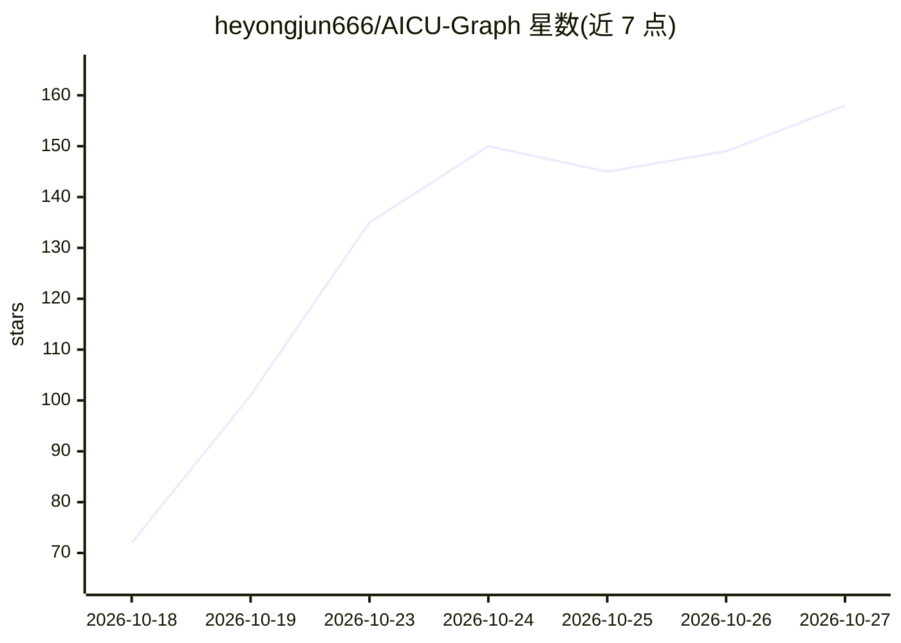

# heyongjun666/AICU-Graph

⭐ 158 · Python · Apache-2.0 · 推送 2026-10-23 · [GitHub](https://github.com/heyongjun666/AICU-Graph) · 个人维护 · 中文 README

**多 Agent 协作平台：自动分解任务、动态组建 AI 团队并协同执行**

AICU-Graph 将复杂任务转化为可视化、持续运行的任务图：自动分析任务、动态组建不同角色（Manager/Worker）的 AI 团队，协调分工、审查交付物并通过定向修订推进工作流。Worker 节点是真实的 AI 编码 CLI 运行（Claude Code、Codex CLI、Gemini CLI 等），通过 PATH 检测适配，角色、技能与 MCP 均可由用户扩展。提供 Web 工作台查看节点日志与事件。限 macOS/Linux，Windows 不支持；服务默认无鉴权，仅限本机或可信网络使用。

## 筛选速览

| 维度 | 判定 | 备注 |
|---|---|---|
| AI 角色 | `ai-ecosystem` | LLM/agent 周边工具 |
| 许可风险 | `permissive` | Apache-2.0 |
| 部署形态 | `library` | 以包/库形式分发 |
| 模型依赖 | — | README 未给出锁定关系 |
| 硬件要求 | — | 无带数字的原话,不猜 |
| 安装摩擦 | `low` | 无编译、无系统依赖或容器化 |
| 成熟度 | — | 结构信号不足 |

## 能力要点

- 任务分解为任务图，动态组建 Manager/Worker 多 Agent 团队
- 驱动 PATH 上的真实 AI 编码 CLI（Claude Code/Codex/Gemini 等 10+ 种）
- 节点检查器、共享工作区、按会话切换 provider 与模型
- 角色、技能与 MCP 均为用户可扩展

## 适用场景

- 把需要设计、实现、测试的复杂任务交给多 Agent 团队协作完成
- 可视化跟踪每个 Agent 节点的日志、输出与事件
- 在软件之外的领域分解并执行可验证的专业化任务

## 场景标签

`多智能体` `Agent 框架` `编码 Agent` · 领域:Agent 开发

## 证据(README 行号)

> L12: AICU-Graph turns a complex task into a visual, continuously running task graph. It can dynamically assemble teams w
> L65: AICU drives real coding CLIs found on your `PATH`. Install one and finish **that CLI's own login / authentication**

## 星数曲线

2026-10-18 72 → 2026-10-27 158（+86）

---
*卡片 v1 · prompt 1.4 · 生成 2026-10-23 · 置信度 mid · 依据 README sha `816de0bb2c28` · [字段定义](../../DATASET.md)*
