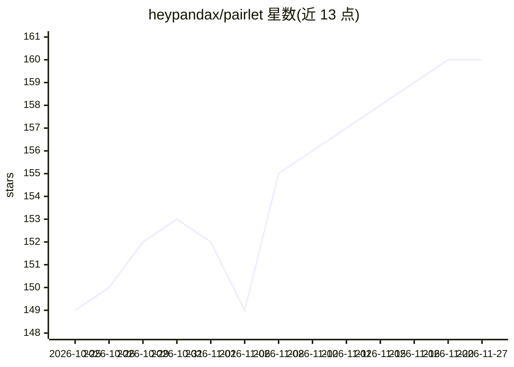

# heypandax/pairlet

⭐ 160 · Kotlin · MIT · 推送 2026-11-25 · [GitHub](https://github.com/heypandax/pairlet) · [官网](https://pairlet.org/) · 个人维护 · 中文 README

**让开发者从手机/平板远程掌控本机命令行编码代理**

Pairlet 是一个开源、本地优先的命令行编码代理控制平面：代理 CLI 继续在用户自己的机器上运行，用户通过手机、平板或另一台电脑观看输出、回复权限审批、接管会话并查看文件改动。流量端到端加密，经零知识中继转发密文，无需账号。v1.9.4 支持 Claude Code、OpenAI Codex、OpenCode、Kimi Code、ZCode、DeepSeek 六个后端，能力各不相同，以能力矩阵为准。桌面应用与本地守护进程是两个不同包。

## 筛选速览

| 维度 | 判定 | 备注 |
|---|---|---|
| AI 角色 | `ai-ecosystem` | LLM/agent 周边工具 |
| 许可风险 | `permissive` | MIT |
| 部署形态 | `desktop` | 安装包/桌面程序 |
| 模型依赖 | — | README 未给出锁定关系 |
| 硬件要求 | — | 无带数字的原话,不猜 |
| 安装摩擦 | `medium` | 含编译或系统依赖之一 |
| 成熟度 | — | 结构信号不足 |

## 能力要点

- 六大代理后端接入，含公开能力矩阵标注各后端差异
- 端到端加密（P-256 ECDH + AES-256-GCM）经零知识中继，无账号无内容日志
- 权限审批推送到手机，超时安全拒绝
- 会话原位接管、重连后回补错过的输出、行级 diff 查看

## 适用场景

- 离开电脑时用手机回复编码代理的权限请求
- 在平板上接管并继续本机正在运行的会话
- 查看代理改动的文件与行级 diff

## 场景标签

`编码 Agent` · 领域:编码与开发

## 证据(README 行号)

> L11: Pairlet is an open-source, local-first control plane for command-line coding agents. The agent keeps running on you
> L13: **v1.9.4** drives six agent backends — Claude Code, OpenAI Codex, OpenCode, Kimi Code (Preview), ZCode and DeepSeek
> L76:     daemon -- "stdio" --> agent["agent CLI (claude · codex · opencode · kimi · zcode · DeepSeek)"]

## 星数曲线

2026-10-25 149 → 2026-11-27 160（+11）

---
*卡片 v1 · prompt 1.4 · 生成 2026-11-27 · 置信度 high · 依据 README sha `1637ffcb5fcd` · [字段定义](../../DATASET.md)*
