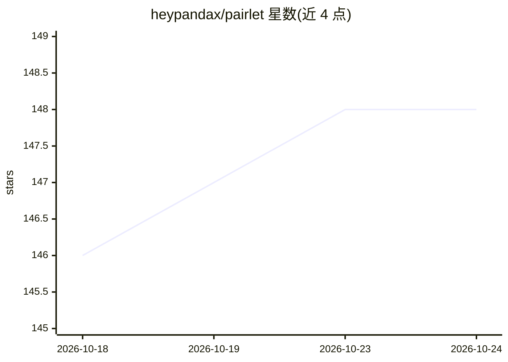

# heypandax/pairlet

⭐ 149 · Kotlin · MIT · 推送 2026-10-17 · [GitHub](https://github.com/heypandax/pairlet) · [官网](https://pairlet.org/) · 个人维护 · 中文 README

**远程控制本地命令行编码代理的开源控制台**

Kotlin 编写的 local-first 控制平面：daemon 在用户自己电脑上以子进程方式驱动编码代理 CLI（v1.9.4 支持 Claude Code、OpenAI Codex、OpenCode、Kimi Code Preview、ZCode、DeepSeek 六种后端，能力有差异），手机/平板/桌面应用通过零知识中继以端到端加密（P-256 ECDH + AES-256-GCM）连接，实现跨设备观看输出、审批权限请求、原地接管会话与行级 diff 检查。代理仍在本地以用户系统权限执行，端到端加密不构成沙箱；自定义 Noise 风格通道未经第三方审计。提供 iOS/Android/桌面安装包与各平台 daemon 安装脚本，中继支持自托管，含中国大陆镜像。

## 筛选速览

| 维度 | 判定 | 备注 |
|---|---|---|
| AI 角色 | `ai-ecosystem` | LLM/agent 周边工具 |
| 许可风险 | `permissive` | MIT |
| 部署形态 | `desktop` | 安装包/桌面程序 |
| 模型依赖 | — | README 未给出锁定关系 |
| 硬件要求 | — | 无带数字的原话,不猜 |
| 安装摩擦 | `medium` | 含编译或系统依赖之一 |
| 成熟度 | — | 结构信号不足 |

## 能力要点

- 六种代理后端，各后端能力以矩阵形式公开声明（含 OpenCode 无强制审批等限制）
- 零知识中继只转发密文，端到端加密，配对可过期与吊销
- 跨设备审批、原地接管运行中会话、重连后回填错过的输出
- 桌面应用与 daemon 分发覆盖 macOS/Windows/Linux 多架构，HarmonyOS 为 Preview

## 适用场景

- 人离开电脑时用手机继续盯编码代理的执行并回复权限弹窗
- 从手机发起新任务或接管正在运行的会话
- 远程审查代理改动的文件与行级 diff

## 场景标签

`编码 Agent` · 领域:编码与开发

## 证据(README 行号)

> L11: Pairlet is an open-source, local-first control plane for command-line coding agents. The agent keeps running on you
> L13: **v1.9.4** drives six agent backends — Claude Code, OpenAI Codex, OpenCode, Kimi Code (Preview), ZCode and DeepSeek
> L76:     daemon -- "stdio" --> agent["agent CLI (claude · codex · opencode · kimi · zcode · DeepSeek)"]

## 星数曲线

2026-10-18 146 → 2026-10-24 148（+2）

---
*卡片 v1 · prompt 1.4 · 生成 2026-10-22 · 置信度 high · 依据 README sha `9341077577db` · [字段定义](../../DATASET.md)*
