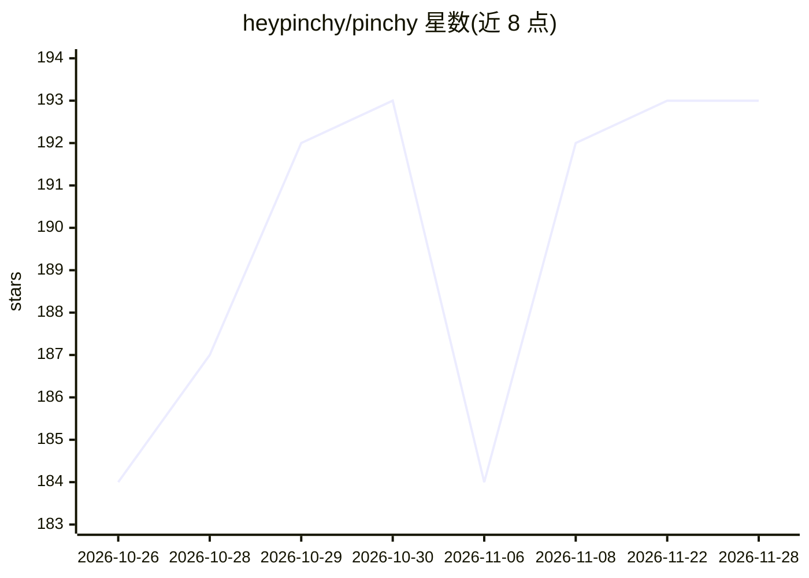

# heypinchy/pinchy

⭐ 193 · TypeScript · AGPL-3.0 · 推送 2026-11-25 · [GitHub](https://github.com/heypinchy/pinchy) · [官网](https://heypinchy.com) · 个人维护

**企业自托管 AI agent 平台：为 OpenClaw 加权限与审计**

基于 OpenClaw agent 框架的企业层：在其上补齐用户管理、RBAC、按 agent 的工具白名单权限、HMAC 签名审计日志，并提供 Web 与 Telegram 两种对话入口。集成 Odoo ERP（20+ 模板）、Gmail/Microsoft 365/IMAP 邮件自动化、Brave 搜索等。通过 Docker Compose 一键部署，可配 Ollama 本地模型实现全离线运行。当前处于早期开发阶段，细粒度 RBAC 与插件市场尚未完成，Groups 与成本明细导出为 Enterprise 功能。

## 筛选速览

| 维度 | 判定 | 备注 |
|---|---|---|
| AI 角色 | `ai-ecosystem` | LLM/agent 周边工具 |
| 许可风险 | `viral` | AGPL-3.0 |
| 部署形态 | `self-host` | docker 或自建部署 |
| 模型依赖 | local-ok | 支持本地模型 |
| 硬件要求 | — | 无带数字的原话,不猜 |
| 安装摩擦 | `low` | 无编译、无系统依赖或容器化 |
| 成熟度 | `idea` | |

## 能力要点

- 按 agent 的工具白名单权限，替代原始 shell 访问
- HMAC 签名、可验证的审计日志与 CSV 导出
- Odoo ERP 集成（20+ 预置模板）与邮件自动化
- 模型无关：OpenAI/Anthropic/Google/Ollama 本地模型

## 适用场景

- 在合规要求下自托管运行企业 AI agent
- 让 agent 以受控权限访问 Odoo ERP 与邮箱
- 通过 Telegram 随时与受权限约束的 agent 对话
- 对 agent 的每次操作留有可验证的审计记录

## 场景标签

`Agent 框架` `聊天机器人` · 领域:Agent 开发

## 证据(README 行号)

> L23: Pinchy is an enterprise layer on top of OpenClaw — the open-source AI agent framework. OpenClaw is incredibly power
> L45: - **Model Agnostic** — OpenAI, Anthropic, local models via Ollama. Your choice.

## 星数曲线

2026-10-26 184 → 2026-11-28 193（+9）

---
*卡片 v1 · prompt 1.4 · 生成 2026-11-25 · 置信度 high · 依据 README sha `e2780bbcbaeb` · [字段定义](../../DATASET.md)*
