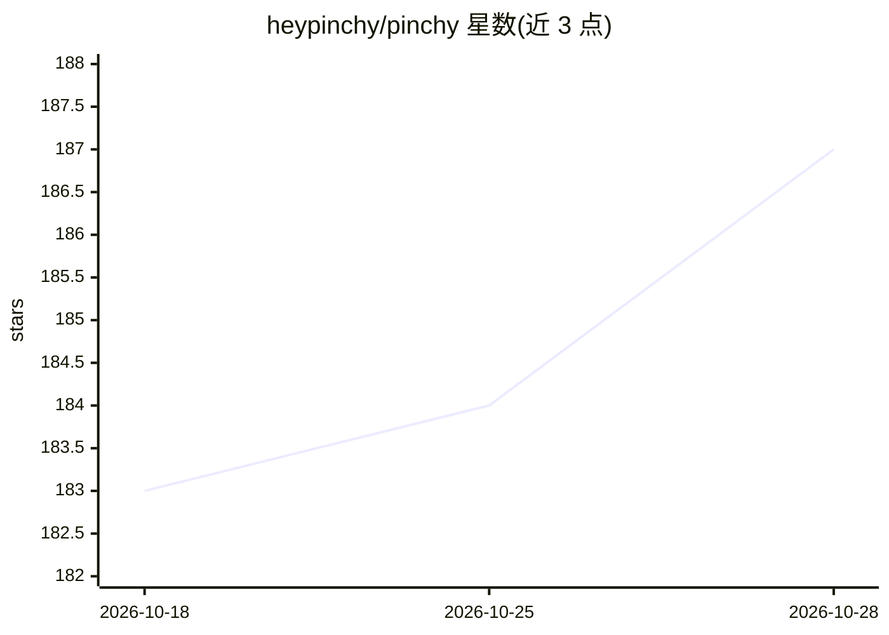

# heypinchy/pinchy

⭐ 192 · TypeScript · AGPL-3.0 · 推送 2026-10-27 · [GitHub](https://github.com/heypinchy/pinchy) · [官网](https://heypinchy.com) · 个人维护

**自托管的企业级 AI agent 平台，基于 OpenClaw 加权限与审计**

在开源 agent 框架 OpenClaw 之上叠加企业治理层的自托管平台：提供按 agent 授权的工具 allow-list、角色访问控制、HMAC 签名的可验证审计日志、多用户管理，以及 Web UI 与 Telegram 两种对话入口。集成覆盖 Odoo ERP、Gmail/Microsoft 365 邮件、Brave 网页搜索。支持 OpenAI、Anthropic、Google 及经 Ollama 的本地模型，可完全离线运行。通过 Docker Compose 单命令部署，AGPL-3.0 许可；自述处于早期开发阶段，细粒度 RBAC 与插件市场仍在路线图中。

## 筛选速览

| 维度 | 判定 | 备注 |
|---|---|---|
| AI 角色 | `ai-ecosystem` | LLM/agent 周边工具 |
| 许可风险 | `viral` | AGPL-3.0 |
| 部署形态 | `self-host` | docker 或自建部署 |
| 模型依赖 | local-ok | 支持本地模型 |
| 硬件要求 | — | 无带数字的原话,不猜 |
| 安装摩擦 | `low` | 无编译、无系统依赖或容器化 |
| 成熟度 | `idea` | |

## 能力要点

- 每 agent 工具 allow-list 与 RBAC 权限控制
- HMAC 签名的防篡改审计日志与 CSV 导出
- Web UI 与 Telegram 多入口，每 agent 一个 bot
- 支持 Ollama 本地模型，可完全离线自托管

## 适用场景

- 企业在内网部署带权限与审计的 AI agent
- 受监管行业让 agent 访问 Odoo 与邮箱且数据不出网
- 团队按角色共享和管控多个 AI agent

## 场景标签

`Agent 框架` `AI 助手` · 领域:Agent 开发

## 证据(README 行号)

> L5:  Self-hosted AI agent platform built on OpenClaw.
> L23: Pinchy is an enterprise layer on top of OpenClaw — the open-source AI agent framework. OpenClaw is incredibly power
> L40: - **Plugin Architecture** — Agents get scoped tools, not raw shell access. A "read Odoo sales orders" tool, not `ex

## 星数曲线

2026-10-18 183 → 2026-10-28 187（+4）

---
*卡片 v1 · prompt 1.4 · 生成 2026-10-22 · 置信度 high · 依据 README sha `32bb6a25b53e` · [字段定义](../../DATASET.md)*
