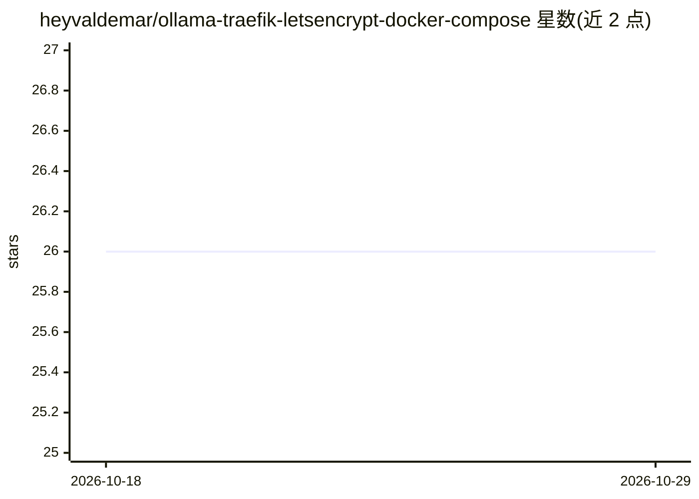

# heyvaldemar/ollama-traefik-letsencrypt-docker-compose

⭐ 26 · Shell · MIT · 推送 2026-10-28 · [GitHub](https://github.com/heyvaldemar/ollama-traefik-letsencrypt-docker-compose) · [官网](https://www.heyvaldemar.com) · 个人维护

**Ollama+Open WebUI+Traefik 的 Docker Compose 部署模板**

面向想在自有 Linux 服务器上部署本地 LLM 服务的运维者/开发者的 Docker Compose 编排模板：整合 Ollama（0.40.11，首次启动按配置列表自动拉取模型）、Open WebUI（0.12 多用户聊天界面）与 Traefik v3（Let's Encrypt 自动证书、HTTP→HTTPS 重定向）。默认不暴露 Ollama API 端口，可选用 basic auth 经 HTTPS 对外开放。上游镜像按 sha256 digest 固定，CI 每次推送验证部署，提供 update.sh 无人值守更新与 Sigstore 签名的发布产物。需自备域名与 DNS 解析，默认模型下载约 12 GB。

## 筛选速览

| 维度 | 判定 | 备注 |
|---|---|---|
| AI 角色 | `ai-ecosystem` | LLM/agent 周边工具 |
| 许可风险 | `permissive` | MIT |
| 部署形态 | `self-host` | docker 或自建部署 |
| 模型依赖 | local-ok | 支持本地模型 |
| 硬件要求 | — | 无带数字的原话,不猜 |
| 安装摩擦 | `low` | 无编译、无系统依赖或容器化 |
| 成熟度 | — | 结构信号不足 |

## 能力要点

- 三个上游镜像按 tag@sha256 digest 固定，CI 每日检查 pin 新鲜度
- Let's Encrypt TLS-ALPN 自动签发与续期，Ollama API 默认不占主机端口
- OLLAMA_INSTALL_MODELS 配置列表在首次启动自动安装模型
- 发布产物带 Sigstore 无密钥签名与 SLSA 构建来源证明

## 适用场景

- 在自有服务器上搭建不依赖云 API 的私有聊天服务
- 为开发提供带 basic auth 的 LLM HTTPS API 后端
- 一台 GPU 机器通过 Open WebUI 账号供多人使用

## 场景标签

`聊天机器人` · 领域:对话与助手

## 证据(README 行号)

> L1: # Ollama + Open WebUI + Traefik + Let's Encrypt on Docker Compose
> L22: Three moving parts (Traefik + Ollama + Open WebUI). No Kubernetes prerequisites, no manual certificate management.
> L128: This repository is a deployment template, not a custom Docker image. It orchestrates three upstream images:

## 星数曲线

2026-10-18 26 → 2026-10-29 26（+0）

---
*卡片 v1 · prompt 1.4 · 生成 2026-10-26 · 置信度 high · 依据 README sha `462296a56585` · [字段定义](../../DATASET.md)*
