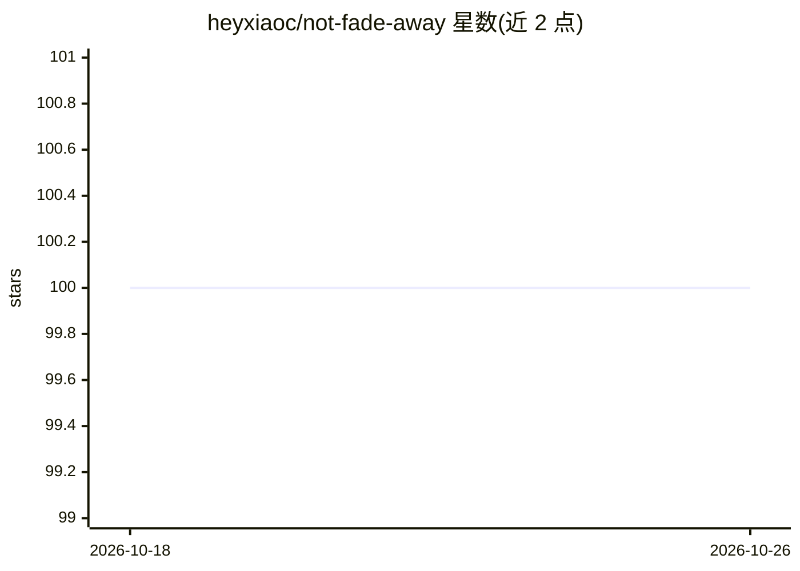

# heyxiaoc/not-fade-away

⭐ 100 · Python · NOASSERTION · 推送 2026-07-16 · [GitHub](https://github.com/heyxiaoc/not-fade-away) · 个人维护 · 中文 README

**教程：在 Mac/VPS 上自托管常驻 Claude AI 伴侣（走订阅、可远程访问）**

一份两版本结构的教程：人看版讲思路，机看版给出接口、字段与配置模板，可直接交给 Claude Code 会话从零搭建。核心是基于 Claude Code 官方 channels 机制，把常驻会话接入自制网页前端，实现常驻、自愈（看门狗 + 进程守护 + 多实例互救）、订阅计费不走按量、Cloudflare Tunnel 远程访问与墙内可用，并扩展多版本 Claude / GPT / Gemini 群聊。番外篇含 Fable 路由应对、transcript 剪枝、非自主回忆等实测记录与配套脚本。以 CC BY 4.0 发布。

## 筛选速览

| 维度 | 判定 | 备注 |
|---|---|---|
| AI 角色 | `ai-knowledge` | 知识聚合/清单类 |
| 许可风险 | `none` | NOASSERTION |
| 部署形态 | `None` |  |
| 模型依赖 | locked-api |  |
| 硬件要求 | — | 无带数字的原话,不猜 |
| 安装摩擦 | `low` | 无编译、无系统依赖或容器化 |
| 成熟度 | — | 结构信号不足 |

## 能力要点

- 基于 Claude Code 官方 channels 机制接入自定义网页前端
- 常驻 + 自愈方案：tmux 真 PTY、health 看门狗、N 实例互救、transcript 剪枝轮换
- 订阅计费判定与墙内可用（资源自托管 + Cloudflare 优选 IP）
- 多模型群聊：多版本 Claude / GPT(codex) / Gemini(Antigravity)

## 适用场景

- 在自家 Mac 或 VPS 上搭一个常驻、走订阅的 Claude 伴侣
- 从手机或网页随时联系带着本地环境的 Claude 会话
- 国内网络环境下远程访问自托管 Claude
- 让多个模型在同一群聊中长期共存并保持各自记忆人设

## 场景标签

`教程课程` `AI 助手` · 领域:对话与助手

## 证据(README 行号)

> L11: Claude Code 有个官方功能叫 **channels**（下面有介绍）：让外部消息注入你常驻的会话、Claude 用 `reply` 工具回，官方用它接 Telegram / Discord / iMessage。这份教程
> L30: |版本|给谁看|内容|
> L33: |**机看版**|喂给 CC|完整技术规格：接口、字段、配置模板，可直接交给一个 Claude Code 会话据此从零搭建|

## 星数曲线

2026-10-18 100 → 2026-10-26 100（+0）

---
*卡片 v1 · prompt 1.4 · 生成 2026-10-23 · 置信度 high · 依据 README sha `2d6e7bea9935` · [字段定义](../../DATASET.md)*
