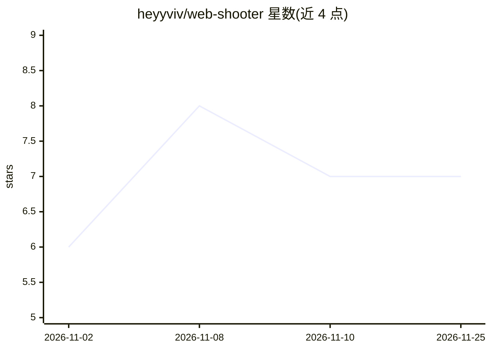

# heyyviv/web-shooter

⭐ 7 · Rust · Apache-2.0 · 推送 2026-11-03 · [GitHub](https://github.com/heyyviv/web-shooter) · 个人维护

**给 AI 助手的低 token 网页阅读与聚焦爬取 MCP 服务器**

以 MCP 服务器形式运行的本地网页读取工具：读取网页与本地 PDF，仅返回回答问题所需的相关段落而非整页，降低 token 消耗。提供 fetch、links、crawl 三个工具，支持按查询排序链接与聚焦爬取；JavaScript 渲染页面自动经无头 Chrome 加载。首次查询下载 30 MB 嵌入模型。通过安装脚本支持 macOS (Apple Silicon)、Linux、Windows，Intel Mac 仅可从源码安装。README 附与其他阅读工具的基准测试数据。

## 筛选速览

| 维度 | 判定 | 备注 |
|---|---|---|
| AI 角色 | `ai-ecosystem` | LLM/agent 周边工具 |
| 许可风险 | `permissive` | Apache-2.0 |
| 部署形态 | `library` | 以包/库形式分发 |
| 模型依赖 | — | README 未给出锁定关系 |
| 硬件要求 | — | 无带数字的原话,不猜 |
| 安装摩擦 | `low` | 无编译、无系统依赖或容器化 |
| 成熟度 | — | 结构信号不足 |

## 能力要点

- 返回按问题排序的相关段落而非整页，约 23 倍更少的 token 返回
- fetch / links / crawl 三个 MCP 工具，覆盖读取、链接排序与聚焦爬取
- 本地运行，不保留数据；JS 页面自动经无头 Chrome 加载
- 提供 Cargo 与 shell/PowerShell 安装脚本

## 适用场景

- 让 Claude Code 等客户端读取网页和 PDF 时减少 token 消耗
- 给 AI agent 提供网页抓取与聚焦爬取能力
- 在本地读取带问题的网页或 PDF 内容

## 场景标签

`网页抓取` `文档解析` · 领域:效率与自动化

## 证据(README 行号)

> L5: A fast web reader for AI assistants, served over MCP. It reads web pages and PDFs and returns only the passages that
> L46: **2. Register it.** In Claude Code:

## 星数曲线

2026-11-02 6 → 2026-11-25 7（+1）

---
*卡片 v1 · prompt 1.4 · 生成 2026-11-20 · 置信度 high · 依据 README sha `09a9973b2535` · [字段定义](../../DATASET.md)*
