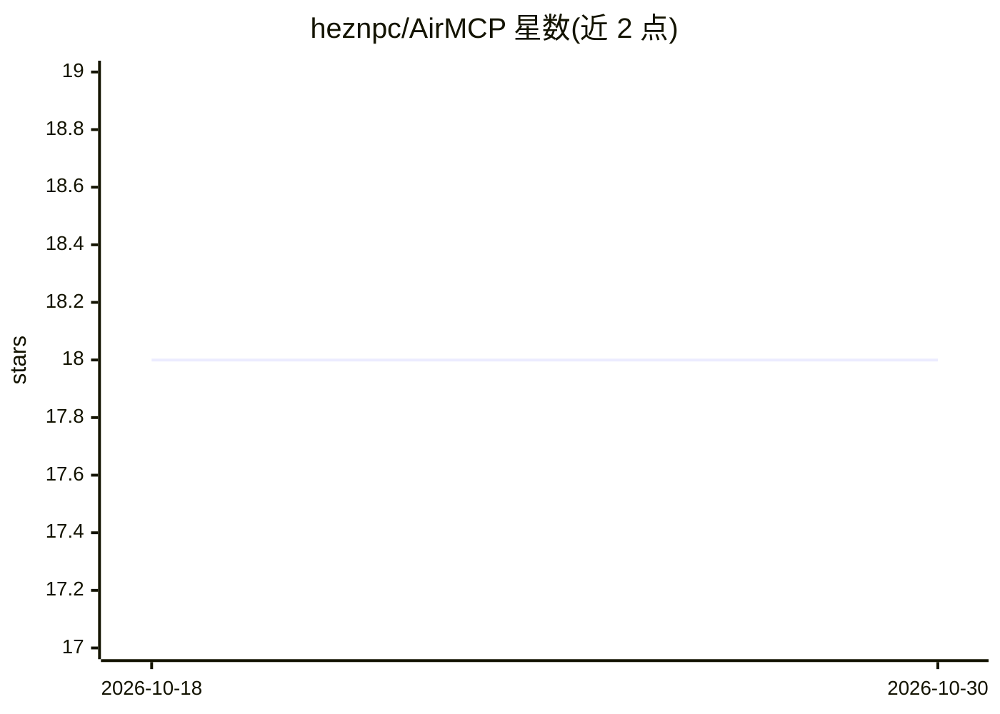

# heznpc/AirMCP

⭐ 18 · JavaScript · MIT · 推送 2026-10-28 · [GitHub](https://github.com/heznpc/AirMCP) · [官网](https://heznpc.github.io/AirMCP/) · 个人维护

**面向 Apple 生态的受治理 MCP 运行时：让 AI 助手操作本机真实应用**

AirMCP 是连接与控制层，而非独立 agent：把 Notes、Mail、Calendar、Messages、Safari、Shortcuts 等 Apple 应用及 Google Workspace 以 293 个工具、32 个模块的 MCP 能力面开放给 Claude、Codex、Cursor 等 MCP 客户端。治理机制包括破坏性调用预览、逐次人工批准（HITL）、HMAC 链式防篡改审计日志、速率限制与紧急停止。macOS 运行时已可用，iOS/iPadOS 处于预览；通过 npm CLI、MCPB 扩展或签名公证的 App ZIP 安装，需 Node.js 20+。注意 v2.16.7 的 App ZIP 因公证问题暂缺。

## 筛选速览

| 维度 | 判定 | 备注 |
|---|---|---|
| AI 角色 | `ai-ecosystem` | LLM/agent 周边工具 |
| 许可风险 | `permissive` | MIT |
| 部署形态 | `desktop` | 安装包/桌面程序 |
| 模型依赖 | locked-api |  |
| 硬件要求 | — | 无带数字的原话,不猜 |
| 安装摩擦 | `low` | 无编译、无系统依赖或容器化 |
| 成熟度 | `idea` | |

## 能力要点

- 293 个工具 / 32 个模块覆盖 Apple 与 Google Workspace 应用
- 破坏性调用预览 + 逐次批准 + HMAC 防篡改审计链
- Profile 与渐进式工具暴露控制上下文占用
- stdio 与 HTTP/SSE 双传输，OAuth 2.1 支持

## 适用场景

- 让 Claude/Codex 等 MCP 客户端读写真实的 Notes、Mail、Calendar
- 以自然语言执行 Morning Routine 等本机 Shortcuts
- 在受审批与审计约束下让 AI 处理日程、邮件与备忘

## 场景标签

`Agent 框架` `GUI 自动化` · 领域:Agent 开发

## 证据(README 行号)

> L45: AirMCP is the connector and control layer, not another agent. Destructive calls
> L36: Then ask your client. Works with Claude, Codex, Cursor, Raycast, Xcode agents,

## 星数曲线

2026-10-18 18 → 2026-10-30 18（+0）

---
*卡片 v1 · prompt 1.4 · 生成 2026-10-29 · 置信度 high · 依据 README sha `71bea41f68eb` · [字段定义](../../DATASET.md)*
