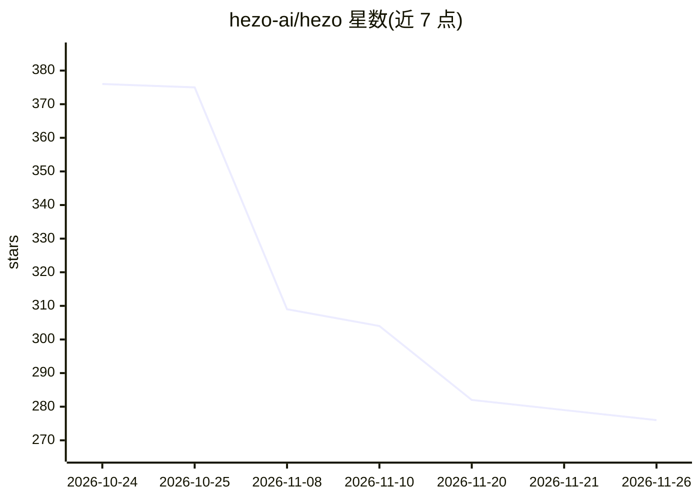

# hezo-ai/hezo

⭐ 276 · TypeScript · GPL-3.0 · 推送 2026-11-20 · [GitHub](https://github.com/hezo-ai/hezo) · [官网](https://hezo.ai) · 组织维护

**像运营公司一样运行 AI agent 团队的自托管服务器与 Web 应用**

Hezo 提供一个开源服务器和 Web 应用，用于以组织结构方式运行 AI agent 团队：可搭建 CEO、Captain、工程师、设计师等角色，内置组织架构、项目、预算上限、审批门与任务板。agent 在独立沙箱容器中运行，凭据以占位符形式存在，由出口代理按允许主机替换真实密钥。各模型通过其第一方 CLI 运行时统一调度，支持自托管单二进制运行或 Hezo Cloud 托管。

## 筛选速览

| 维度 | 判定 | 备注 |
|---|---|---|
| AI 角色 | `ai-native` | 本体是模型或模型工具 |
| 许可风险 | `viral` | GPL-3.0 |
| 部署形态 | `None` |  |
| 模型依赖 | local-ok | 支持本地模型 |
| 硬件要求 | — | 无带数字的原话,不猜 |
| 安装摩擦 | `low` | 无编译、无系统依赖或容器化 |
| 成熟度 | — | 结构信号不足 |

## 能力要点

- 组织化 agent 团队：CEO/Captain/worker 层级、审批门、任务板与心跳唤醒
- 密钥占位符 + 出口代理按主机白名单替换，agent 不接触真实凭据
- meta-harness 统一调度 Claude Code、Codex、Kimi Code 等第一方 CLI 运行时
- 支持 Ollama 与 LM Studio 本地模型，容器时长与花费记账，内置 MCP 服务器

## 适用场景

- 以项目为单位让 agent 团队自主完成开发、营销等任务
- 给每个 agent 配不同模型并设置预算上限控制成本
- 通过 Slack/Telegram/Discord 随时向 CEO agent 下达指令
- 本地运行开源模型驱动 agent，避免按 token 付费

## 场景标签

`编码 Agent` `多智能体` · 领域:Agent 开发

## 证据(README 行号)

> L33: Hezo is an open source server and web app for running **teams of AI agents like an
> L105: 1. **Create a project and pick a team.** Launch a ready-made team from the
> L114: 3. **The team gets to work.** Agents pick up tasks and work

## 星数曲线

2026-10-24 376 → 2026-11-26 276（-100）

---
*卡片 v1 · prompt 1.4 · 生成 2026-11-25 · 置信度 high · 依据 README sha `e28b5fbec695` · [字段定义](../../DATASET.md)*
