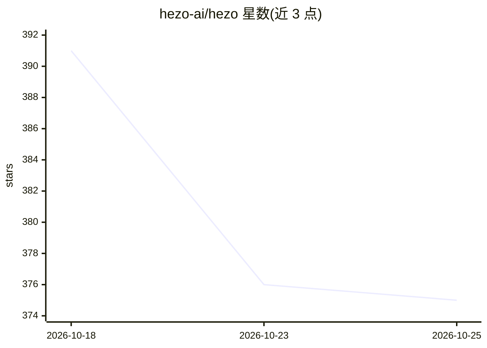

# hezo-ai/hezo

⭐ 375 · TypeScript · GPL-3.0 · 推送 2026-10-24 · [GitHub](https://github.com/hezo-ai/hezo) · [官网](https://hezo.ai) · 个人维护

**开源的 AI agent 团队运行平台：按组织架构编排多 agent 协作**

自托管的服务器与 Web 应用（单个二进制文件），以公司组织方式运行 AI agent 团队：可设 CEO、Captain、工程师等角色，配备任务板、审批门槛、预算上限与按项目沙箱隔离的容器。通过各家第一方 CLI（Claude Code、Codex 等）接入 Anthropic/OpenAI/Google/xAI/Ollama 等模型，支持自带 API key。安全机制包括密钥占位符加出站代理替换、静态加密与审计日志；另有付费托管版 Hezo Cloud。本机运行需 Docker 兼容运行时（或改用托管沙箱）。

## 筛选速览

| 维度 | 判定 | 备注 |
|---|---|---|
| AI 角色 | `ai-ecosystem` | LLM/agent 周边工具 |
| 许可风险 | `viral` | GPL-3.0 |
| 部署形态 | `None` |  |
| 模型依赖 | local-ok | 支持本地模型 |
| 硬件要求 | — | 无带数字的原话,不猜 |
| 安装摩擦 | `low` | 无编译、无系统依赖或容器化 |
| 成熟度 | — | 结构信号不足 |

## 能力要点

- 组织式多 agent 编排：CEO/Captain/工人角色、任务板与审批门槛
- 密钥占位符 + 出站代理按主机白名单替换，agent 不接触真实凭据
- 通过第一方 CLI 运行 10 家模型提供商（含本地 Ollama/LM Studio）
- Coach 在任务完成后将经验写回 agent 形成可复用规则

## 适用场景

- 让一组 AI agent 自主推进真实仓库上的开发任务
- 从 Slack/Telegram/Discord 向 CEO agent 询问项目状态
- 按预算上限和容器时长额度控制多 agent 运行开销

## 场景标签

`多智能体` `编码 Agent` · 领域:Agent 开发

## 证据(README 行号)

> L32: Hezo is an open source server and web app for running **teams of AI agents like an
> L133: - **One platform layer over every model.** The meta-harness
> L209: driven through a **first-party agentic command-line runtime** inside the container.

## 星数曲线

2026-10-18 391 → 2026-10-25 375（-16）

---
*卡片 v1 · prompt 1.4 · 生成 2026-10-22 · 置信度 high · 依据 README sha `889b5c2fc28f` · [字段定义](../../DATASET.md)*
