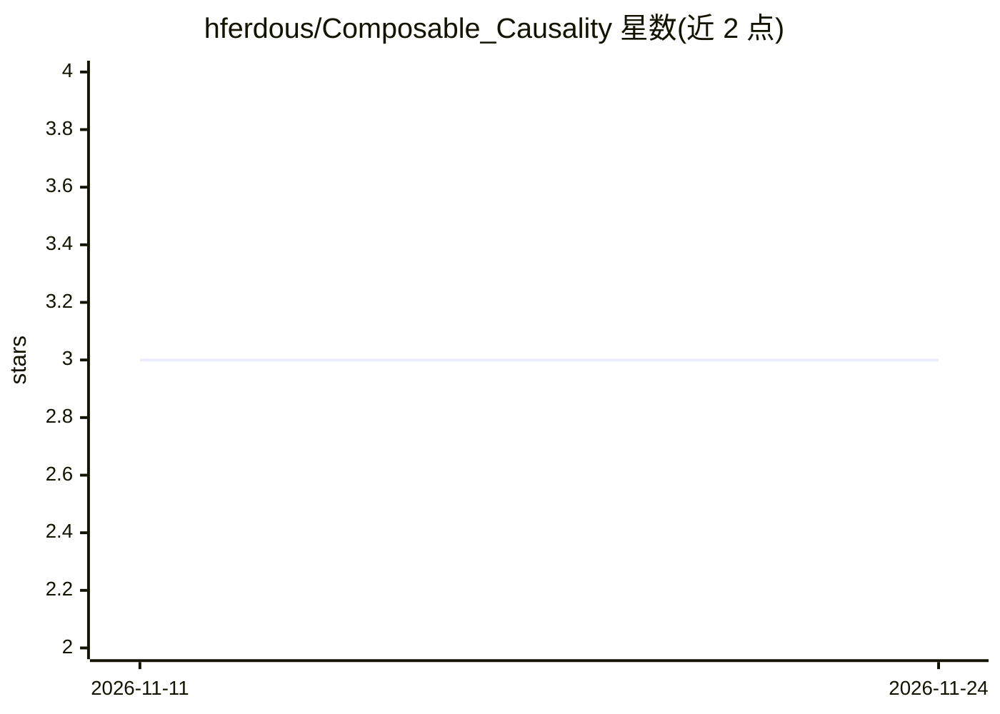

# hferdous/Composable_Causality

⭐ 3 · Python · Apache-2.0 · 推送 2026-11-06 · [GitHub](https://github.com/hferdous/Composable_Causality) · 个人维护

**时序因果发现与处理效应基准数据生成工具箱**

DTCD（Datasets and Toolkit for Causal Discovery）配套仓库：生成带真实同期与滞后因果图的多变量时间序列，图拓扑、结构机制、噪声分布、观测掩码与干预策略各组件独立可变；通过缓存并复用噪声实现生成事实/干预孪生轨迹，得到浮点精度精确的反事实个体处理效应。提供 Python 库、10 种发现基线与 4 种 CATE 估计器封装、参考基准管线，以及一条命令重建论文全部表格与图。核心安装即可运行示例与重建结果，第三方基线经 extras 按需安装。

## 筛选速览

| 维度 | 判定 | 备注 |
|---|---|---|
| AI 角色 | `ai-knowledge` | 知识聚合/清单类 |
| 许可风险 | `permissive` | Apache-2.0 |
| 部署形态 | `library` | 以包/库形式分发 |
| 模型依赖 | — | README 未给出锁定关系 |
| 硬件要求 | — | 无带数字的原话,不猜 |
| 安装摩擦 | `low` | 无编译、无系统依赖或容器化 |
| 成熟度 | — | 结构信号不足 |

## 能力要点

- 模块化生成器：拓扑/机制/噪声/掩码/干预各轴独立变动
- 噪声缓存复用生成事实-干预孪生轨迹，反事实效应精确到浮点精度
- 基准管线含 Optuna 调参与 varsortability 审计，结果可一键复现
- 提供导出接口对接 tigramite 与 causal-learn

## 适用场景

- 为时序因果发现方法生成带真值的评测数据
- 复现或扩展论文中的发现与 CATE 基准
- 在其他因果库中直接使用生成的真值图
- 评估方法在缺失值、非平稳、季节性等变体下的表现

## 场景标签

`模型评测` · 领域:评测与运维

## 证据(README 行号)

> L3: Code, data, and results for **Composable Causality: A Toolkit for Systematic Time-Series Causal Discovery and Treatm
> L5: DTCD (Datasets and Toolkit for Causal Discovery) generates multivariate time series together with their ground-truth
> L9: The repository contains the library (`src/dtcd/`), the reference benchmark and every additional experiment reported 

## 星数曲线

2026-11-11 3 → 2026-11-24 3（+0）

---
*卡片 v1 · prompt 1.4 · 生成 2026-11-21 · 置信度 high · 依据 README sha `79e078aae79b` · [字段定义](../../DATASET.md)*
