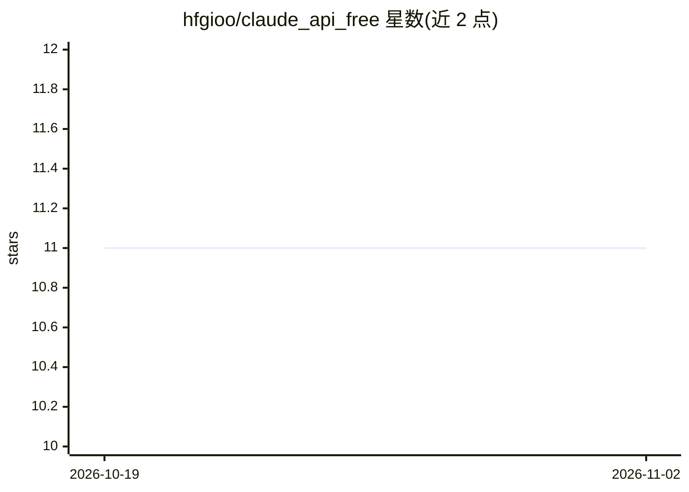

# hfgioo/claude_api_free

⭐ 11 · Python · MIT · 推送 2025-12-21 · [GitHub](https://github.com/hfgioo/claude_api_free) · [官网](https://api.qidianai.xyz) · 组织维护 · 中文 README

**面向国内用户的 AI API 中转服务：免费/付费模型接口**

由奇点字节科技运营的付费/免费混合 AI API 服务，提供 Claude Sonnet 4.5、GLM-4.6、Qwen3-Coder-Plus 三个免费模型，付费模型按 0.39 元/美元额度计价，宣称价格与官方同步。服务兼容 OpenAI API 协议，通过设置 API 地址与环境变量即可接入 Cursor、Claude Code、Continue、LangChain 等工具。宣称不记录对话内容与 IP。使用方式为在官网注册并创建 API Key，无本地安装环节。

## 筛选速览

| 维度 | 判定 | 备注 |
|---|---|---|
| AI 角色 | `ai-ecosystem` | LLM/agent 周边工具 |
| 许可风险 | `permissive` | MIT |
| 部署形态 | `None` |  |
| 模型依赖 | — | README 未给出锁定关系 |
| 硬件要求 | — | 无带数字的原话,不猜 |
| 安装摩擦 | `low` | 无编译、无系统依赖或容器化 |
| 成熟度 | — | 结构信号不足 |

## 能力要点

- 兼容 OpenAI API 协议，可接入多数主流工具
- 提供 3 个免费模型（Claude Sonnet 4.5 / GLM-4.6 / Qwen3-Coder-Plus）
- 付费模型按 0.39 元/刀额度计价，消费日志可查
- 国内网络直连，无需代理

## 适用场景

- 我在国内想直连使用 Claude/OpenAI 协议的模型 API
- 我想给 Cursor、Claude Code 等工具换一个 API 供应商
- 我想先用免费额度试用编码类模型

## 场景标签

`模型网关` · 领域:Agent 开发

## 证据(README 行号)

> L43: 我们支持**所有使用 OpenAI API 协议**的工具和应用：
> L87: **API 地址**：`https://api.qidianai.xyz`

## 星数曲线

2026-10-19 11 → 2026-11-02 11（+0）

---
*卡片 v1 · prompt 1.4 · 生成 2026-11-02 · 置信度 high · 依据 README sha `3f7574865042` · [字段定义](../../DATASET.md)*
