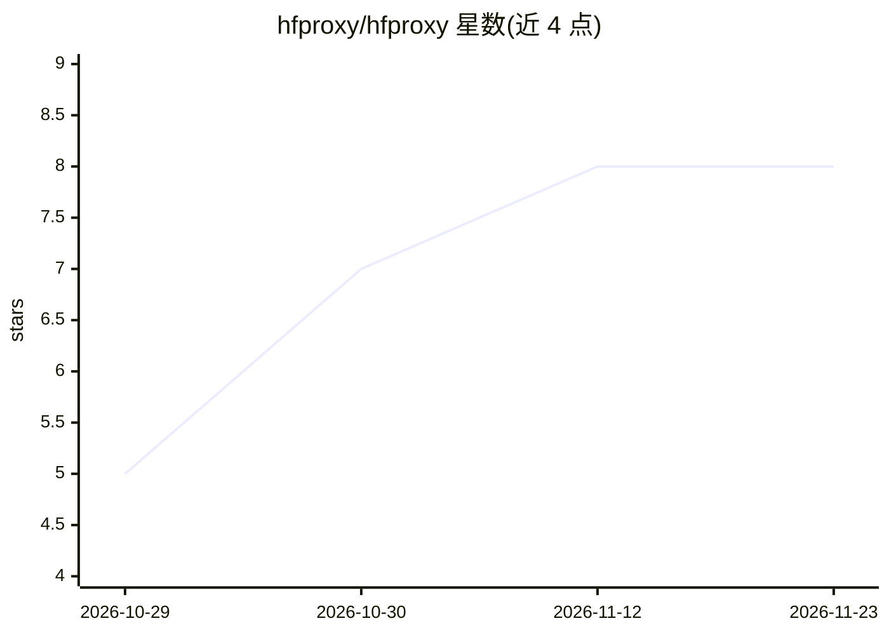

# hfproxy/hfproxy

⭐ 8 · Go · MIT · 推送 2026-11-18 · [GitHub](https://github.com/hfproxy/hfproxy) · 组织维护

**面向组织的自托管 Hugging Face Hub 私有缓存代理**

以 Go 编写、以容器镜像分发的 Hugging Face Hub 代理：部署在团队与 Hub 之间，首次读取时从 Hub 拉取模型与数据集，按 SHA-256 去重后存入自有的 S3 兼容存储，后续读取不离开内网；通过设置 HF_ENDPOINT 使既有客户端工具无需改动即可使用。提供按仓库的访问策略（admin_only/公开/用户组允许清单）、本地用户与令牌、OIDC/SSO、LDAP 组同步、审计日志，并支持用户向代理发布自有模型与数据集（Git LFS、配额与文件大小限制）。要求 PostgreSQL 与 S3 兼容存储；不支持 Xet、git over HTTP、inference 与 Spaces 执行。

## 筛选速览

| 维度 | 判定 | 备注 |
|---|---|---|
| AI 角色 | `ai-ecosystem` | LLM/agent 周边工具 |
| 许可风险 | `permissive` | MIT |
| 部署形态 | `self-host` | docker 或自建部署 |
| 模型依赖 | — | README 未给出锁定关系 |
| 硬件要求 | — | 无带数字的原话,不猜 |
| 安装摩擦 | `low` | 无编译、无系统依赖或容器化 |
| 成熟度 | — | 结构信号不足 |

## 能力要点

- SHA-256 去重缓存，首次下载后内网复用，支持五种淘汰策略与修订固定
- 按仓库访问策略与哈希令牌、OIDC/SSO、LDAP/LDAPS 组同步
- 支持用户向代理发布自有模型/数据集，公共仓库匿名只读
- 运维组件：Prometheus 指标、OpenTelemetry 追踪、Grafana 仪表盘、Helm chart、七语种管理控制台

## 适用场景

- 组织内统一缓存 Hugging Face 模型与数据集下载
- 按用户/组控制谁可以读取哪些仓库
- 在内网向团队成员发布自有的模型与数据集
- Hub 不可用时依赖断路器与陈旧缓存继续服务

## 场景标签

 · 领域:AI 基础设施/模型分发与缓存

## 证据(README 行号)

> L10: **A private Hugging Face Hub for your organization.** hfproxy sits between your teams and the Hub: it caches models
> L23: - **No client changes.** `from_pretrained`, `hf_hub_download`, `snapshot_download` and `datasets` work unchanged wi

## 星数曲线

2026-10-29 5 → 2026-11-23 8（+3）

---
*卡片 v1 · prompt 1.4 · 生成 2026-11-20 · 置信度 high · 依据 README sha `e992f902b3c7` · [字段定义](../../DATASET.md)*
