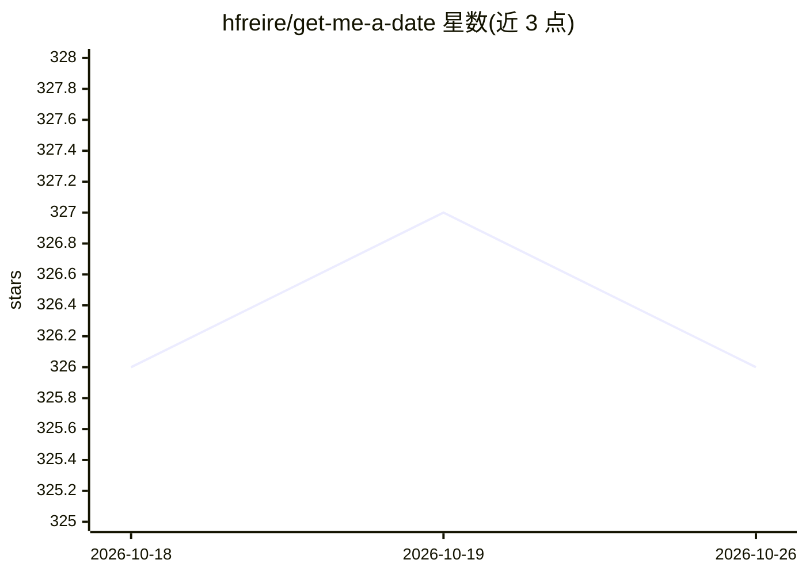

# hfreire/get-me-a-date

⭐ 326 · JavaScript · MIT · 推送 2026-02-15 · [GitHub](https://github.com/hfreire/get-me-a-date) · 个人维护

**用 AWS 识图自动给交友软件推荐点赞/点踩的机器人**

面向交友软件用户的自动化工具：支持 Tinder、Happn、Mint 三个应用，周期性获取推荐对象，调用 AWS Rekognition 的深度学习图像识别分析照片，并利用已有匹配对象做机器学习训练，自动对新推荐执行点赞或点踩。以 Docker 容器形式运行，暴露 REST API（端口 5940，含 Swagger 文档），需配置 Facebook 登录凭据与 AWS 密钥（S3 + Rekognition）等环境变量。源码构建依赖 NPM 脚本。

## 筛选速览

| 维度 | 判定 | 备注 |
|---|---|---|
| AI 角色 | `ai-native` | 本体是模型或模型工具 |
| 许可风险 | `permissive` | MIT |
| 部署形态 | `self-host` | docker 或自建部署 |
| 模型依赖 | — | README 未给出锁定关系 |
| 硬件要求 | — | 无带数字的原话,不猜 |
| 安装摩擦 | `low` | 无编译、无系统依赖或容器化 |
| 成熟度 | — | 结构信号不足 |

## 能力要点

- 支持 Tinder / Happn / Mint 三个交友应用
- AWS Rekognition 深度学习图像识别分析照片
- 用已有匹配对象做机器学习，自动点赞/点踩新推荐
- Docker 容器运行，附 REST API 与 Swagger 文档

## 适用场景

- 我睡觉或忙时让机器人自动筛选交友软件推荐
- 用已有匹配偏好训练自动点赞策略

## 场景标签

`人脸识别` · 领域:感知与多模态

## 证据(README 行号)

> L9: > Uses AWS Rekognition deep learning-based image recognition to help you automate your date discovery.
> L15: * Uses your existing matches :revolving_hearts: for machine-learning :robot: when to :+1: or :-1: new recommendatio

## 星数曲线

2026-10-18 326 → 2026-10-26 326（+0）

---
*卡片 v1 · prompt 1.4 · 生成 2026-10-21 · 置信度 high · 依据 README sha `3e3470f6709c` · [字段定义](../../DATASET.md)*
