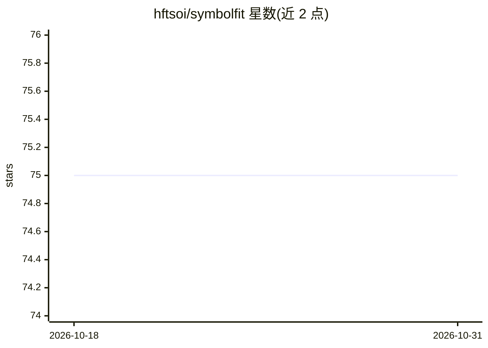

# hftsoi/symbolfit

⭐ 75 · Python · MIT · 推送 2026-10-26 · [GitHub](https://github.com/hftsoi/symbolfit) · [官网](https://hftsoi.github.io/symbolfit/) · 个人维护

**自动符号回归参数拟合库：为数据寻找带不确定度的闭式函数**

面向实验高能物理分析及其他 1D/2D/更高维数据拟合需求的 Python 库：链式组合三步流水线——用 PySR 符号回归搜索函数形式、用 LMFIT 重新优化数值参数并给出协方差不确定度、对每个候选自动评分（chi2/NDF、p 值、RMSE、R2）并绘图。输出六个文件（CSV 参数表与 PDF 图表），无输入不确定度时可做无权重最小二乘拟合。Julia 后端在首次导入 PySR 时自动安装。

## 筛选速览

| 维度 | 判定 | 备注 |
|---|---|---|
| AI 角色 | `ai-native` | 本体是模型或模型工具 |
| 许可风险 | `permissive` | MIT |
| 部署形态 | `library` | 以包/库形式分发 |
| 模型依赖 | — | README 未给出锁定关系 |
| 硬件要求 | — | 无带数字的原话,不猜 |
| 安装摩擦 | `low` | 无编译、无系统依赖或容器化 |
| 成熟度 | — | 结构信号不足 |

## 能力要点

- PySR 符号回归搜索函数形式，无需预定义模板
- LMFIT 参数重优化与协方差不确定度估计
- 候选函数自动评分（chi2/NDF、p 值、RMSE、R2）
- 输出 CSV 表与 PDF 图（含蒙特卡洛不确定度带、相关性矩阵）

## 适用场景

- 为 HEP 分析拟合直方图并做假设检验前的参数建模
- 任意 1D/2D 数据寻找可解释的闭式参数模型
- 对比多个候选函数的拟合优度与不确定度

## 场景标签

`数据分析` · 领域:效率与自动化

## 证据(README 行号)

> L9: **SymbolFit automatically finds closed-form functions that fit your data with uncertainty estimation, no manual gues
> L15: 1. **Function search**: PySR (symbolic regression) explores combinations of mathematical operators to discover func

## 星数曲线

2026-10-18 75 → 2026-10-31 75（+0）

---
*卡片 v1 · prompt 1.4 · 生成 2026-10-24 · 置信度 high · 依据 README sha `d546c56ebd4c` · [字段定义](../../DATASET.md)*
