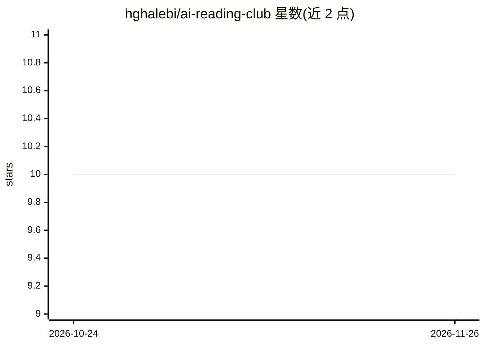

# hghalebi/ai-reading-club

⭐ 10 · Rust · MIT · 推送 2026-06-07 · [GitHub](https://github.com/hghalebi/ai-reading-club) · [官网](https://rust-ml.com/) · 个人维护

**研读现代语言模型基础论文的读书会仓库**

用于组织 AI 论文读书会的轻量仓库：围绕现代语言模型的 14 篇基础论文编排课程，分架构、可解释性、生成解码、数据、效率与微调对齐六个模块，另含补充论文。按每两周一篇的节奏组织，通过 GitHub issue 模板管理各场次，提供公告模板、组织者提示与会史存档。部分场次配有可运行的 workshop 材料，含 Rust 实现的 BPE 分词器与 BERT 注意力分析论文的逐步复现。

## 筛选速览

| 维度 | 判定 | 备注 |
|---|---|---|
| AI 角色 | `ai-knowledge` | 知识聚合/清单类 |
| 许可风险 | `permissive` | MIT |
| 部署形态 | `None` |  |
| 模型依赖 | — | README 未给出锁定关系 |
| 硬件要求 | — | 无带数字的原话,不猜 |
| 安装摩擦 | `low` | 无编译、无系统依赖或容器化 |
| 成熟度 | — | 结构信号不足 |

## 能力要点

- 14 篇基础论文分 6 个模块的课程编排
- 每两周一场的会话组织流程与 GitHub issue 模板
- Rust 实现的 BPE 分词器与 BERT 注意力论文复现材料
- 公告模板、组织者提示与会史文档

## 适用场景

- 组织团队或社区的 LLM 论文研读会
- 按模块化路线系统阅读注意力、LoRA、量化等方向的原始论文
- 复用其 issue 模板与公告模板搭建自己的读书会

## 场景标签

`教程课程` · 领域:学习与行业

## 证据(README 行号)

> L5: A lightweight repository for running an AI Reading Club on foundational papers in modern language models.
> L27: ## Curriculum (14 Papers)
> L11: The club reads foundational AI papers, discusses what they really mean, and connects them to modern LLM systems. So

## 星数曲线

2026-10-24 10 → 2026-11-26 10（+0）

---
*卡片 v1 · prompt 1.4 · 生成 2026-11-19 · 置信度 high · 依据 README sha `cbbe4f24dccf` · [字段定义](../../DATASET.md)*
