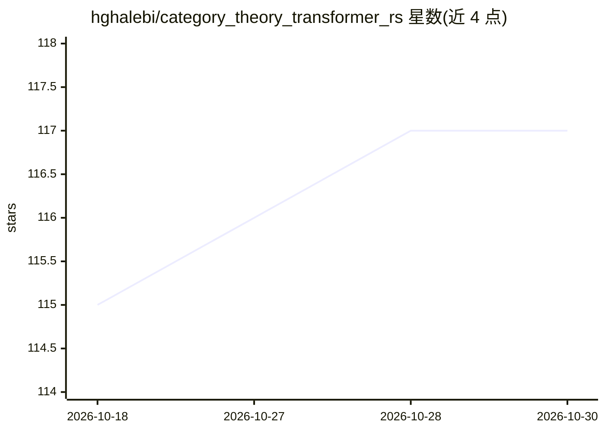

# hghalebi/category_theory_transformer_rs

⭐ 117 · Rust · NOASSERTION · 推送 2026-05-20 · [GitHub](https://github.com/hghalebi/category_theory_transformer_rs) · [官网](https://hghalebi.github.io/category_theory_transformer_rs/) · 个人维护

**用 Rust 类型与范畴论讲解微型 ML 结构的可执行教程书**

公开工作草稿状态的教材项目：将微型机器学习管线（TokenId→Vector→Logits→Distribution）表述为 Rust 类型化的态射与组合，用编译检查使结构显式可见。面向想理解框架层之下结构的 Rust 开发者、ML 工程师与技术创始人，不要求范畴论背景。提供 mdbook 在线书、cargo 可运行的示例与主程序、Typed AI Rustlings 修编译错误练习、Paper-To-Rust 挑战，以及多条按读者身份划分的阅读与公开评审路径。

## 筛选速览

| 维度 | 判定 | 备注 |
|---|---|---|
| AI 角色 | `ai-knowledge` | 知识聚合/清单类 |
| 许可风险 | `none` | NOASSERTION |
| 部署形态 | `None` |  |
| 模型依赖 | — | README 未给出锁定关系 |
| 硬件要求 | — | 无带数字的原话,不猜 |
| 安装摩擦 | `low` | 无编译、无系统依赖或容器化 |
| 成熟度 | `idea` | |

## 能力要点

- 以 Typed Rust 类型（TokenId/Morphism/Parameters 等）表述 ML 管线，编译检查结构
- 提供 cargo run 可运行的示例与主 walkthrough（category_ml）
- Typed AI Rustlings 与 Paper-To-Rust 两条公开挑战赛道
- 按 Rust 工程师/ML 工程师/范畴论读者等视角给出多条学习与评审路径

## 适用场景

- 作为 Rust 开发者从第一性原理理解 ML 系统结构
- 通过修编译错误的小练习学习 AI 概念
- 把注意力机制、训练等概念映射到类型化对象以修正心智模型

## 场景标签

`教程课程` · 领域:学习与行业

## 证据(README 行号)

> L10: This is a first-principles, compile-checked tutorial for engineers who want to
> L11: understand the structure underneath machine-learning systems.
> L246: By following the project, you will learn how to see tiny ML systems as

## 星数曲线

2026-10-18 115 → 2026-10-30 117（+2）

---
*卡片 v1 · prompt 1.4 · 生成 2026-10-23 · 置信度 high · 依据 README sha `70c66f6f4bc8` · [字段定义](../../DATASET.md)*
