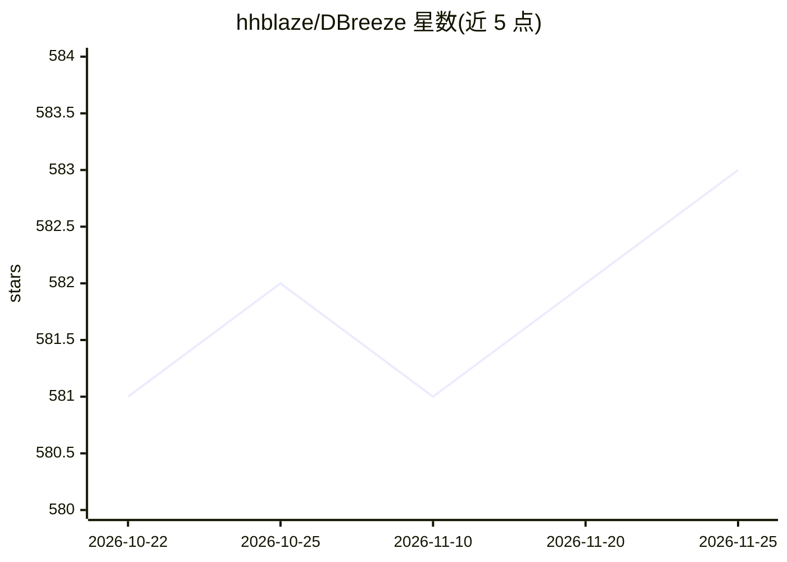

# hhblaze/DBreeze

⭐ 583 · C# · BSD-2-Clause · 推送 2026-11-11 · [GitHub](https://github.com/hhblaze/DBreeze) · 个人维护

**面向 .NET 开发者的嵌入式多范式 NoSQL 数据库**

以 C# 编写的嵌入式数据库系统，提供 Key-Value 存储、对象层、全文检索、多参数检索及基于 HNSW 的向量相似检索与聚类。运行于 .NET Framework/.NET Core/.NET Standard/Xamarin/UWP/Unity 等平台，支持 Windows/Linux/OS X 及 Android/iOS。采用 ACID 事务、多线程与 Liana-Trie 索引；通过 NuGet 分发 DLL，自 2012 年起在维护者自有生产环境使用。

## 筛选速览

| 维度 | 判定 | 备注 |
|---|---|---|
| AI 角色 | `ai-enhanced` | 去掉 AI 部分产品仍成立 |
| 许可风险 | `permissive` | BSD-2-Clause |
| 部署形态 | `None` |  |
| 模型依赖 | — | README 未给出锁定关系 |
| 硬件要求 | — | 无带数字的原话,不猜 |
| 安装摩擦 | `medium` | 含编译或系统依赖之一 |
| 成熟度 | — | 结构信号不足 |

## 能力要点

- 嵌入式 Key-Value 存储，无需外部依赖库
- 集成向量数据库层、相似检索与聚类（HNSW + TurboQuant）
- ACID 事务、增量备份、Raft 高可用
- 支持 .NET 全系列平台与移动端（Xamarin/Unity）

## 适用场景

- 为 .NET 应用嵌入键值/对象数据存储
- 在应用内实现全文与向量相似检索
- 物联网与移动端的本地数据管理

## 场景标签

`向量数据库` · 领域:知识与检索

## 证据(README 行号)

> L11: DBreeze Database is a professional, open-source, multi-paradigm (embedded Key-Value store, objects, NoSql, text sea
> L60: - Integrated Vector Database Layer / Similarity Search Engine / Clustering, based on HNSW Graphs and TurboQuant vec

## 星数曲线

2026-10-22 581 → 2026-11-25 583（+2）

---
*卡片 v1 · prompt 1.4 · 生成 2026-11-25 · 置信度 high · 依据 README sha `195f986644a9` · [字段定义](../../DATASET.md)*
