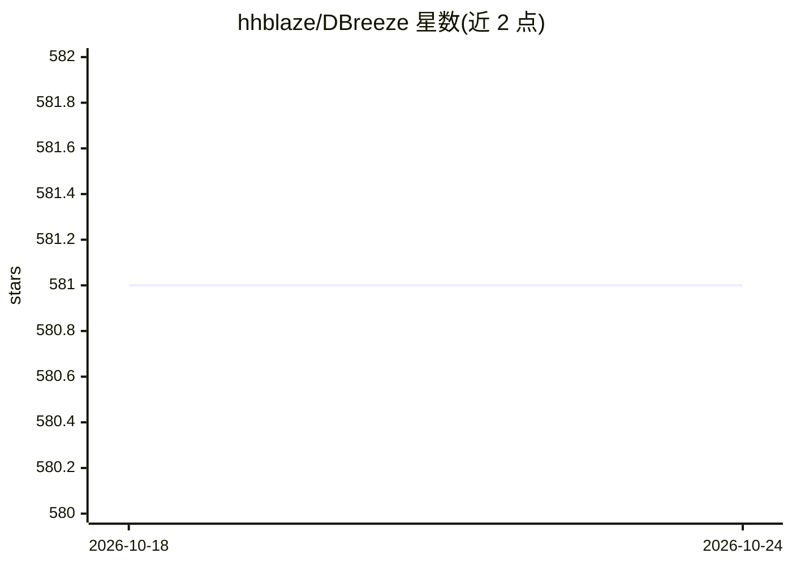

# hhblaze/DBreeze

⭐ 581 · C# · BSD-2-Clause · 推送 2026-10-16 · [GitHub](https://github.com/hhblaze/DBreeze) · 个人维护

**面向 .NET 的嵌入式多范式 NoSQL 数据库，含向量与全文检索**

用 C# 编写的嵌入式事务型 ACID 数据库，以键值存储为核心，同时提供对象数据库层、全文/部分文本搜索、多参数搜索，以及基于 HNSW 图与 TurboQuant 压缩的向量数据库层与相似性检索/聚类。支持 .NET Framework 3.5>、.NET Core、.NET Standard、Xamarin（Android/iOS）、UWP 等平台，可运行于 Linux/Windows/OS X，适合服务器、桌面、移动与物联网场景。自 2012 年 6 月用于作者生产环境，通过 NuGet 分发，可经 Raft.NET 实现高可用与冗余。单进程嵌入，不依赖外部服务。

## 筛选速览

| 维度 | 判定 | 备注 |
|---|---|---|
| AI 角色 | `ai-enhanced` | 去掉 AI 部分产品仍成立 |
| 许可风险 | `permissive` | BSD-2-Clause |
| 部署形态 | `None` |  |
| 模型依赖 | — | README 未给出锁定关系 |
| 硬件要求 | — | 无带数字的原话,不猜 |
| 安装摩擦 | `medium` | 含编译或系统依赖之一 |
| 成熟度 | — | 结构信号不足 |

## 能力要点

- Liana-Trie 索引，键无需碎片整理，插入/更新速度不随时间衰减
- 基于 HNSW 图与 TurboQuant 压缩的向量层/相似性检索/聚类
- 集成全文搜索、多参数搜索与对象数据库层
- 经 Raft.NET 提供高可用、冗余与容错

## 适用场景

- 在 .NET 应用中嵌入一个无外部依赖的键值/对象数据库
- 为检索应用存储向量并做相似性搜索与聚类
- 需要 ACID 事务、增量备份与范围遍历的本地数据存储

## 场景标签

`向量数据库` · 领域:知识与检索

## 证据(README 行号)

> L11: DBreeze Database is a professional, open-source, multi-paradigm (embedded Key-Value store, objects, NoSql, text sea
> L60: - Integrated Vector Database Layer / Similarity Search Engine / Clustering, based on HNSW Graphs and TurboQuant vec

## 星数曲线

2026-10-18 581 → 2026-10-24 581（+0）

---
*卡片 v1 · prompt 1.4 · 生成 2026-10-21 · 置信度 mid · 依据 README sha `0117336bfa62` · [字段定义](../../DATASET.md)*
