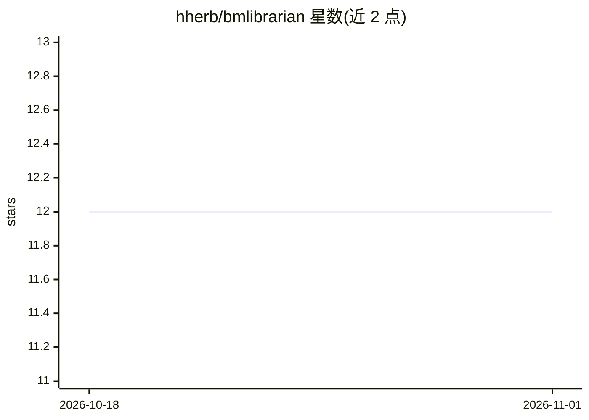

# hherb/bmlibrarian

⭐ 12 · Python · 推送 2026-10-30 · [GitHub](https://github.com/hherb/bmlibrarian) · [官网](https://bmlibrarian.org/) · 个人维护

**面向生物医学研究者的本地 AI 文献研究工作台**

为生物医学研究者、临床医生与系统综述撰写者提供的 AI 平台，功能包括：临床问题的证据支撑式回答、论文自动化质量评估（PRISMA 2020、PICO 提取、证据权重评分）、生物医学陈述的事实验证与反事实分析，以及遵循 PRISMA 的系统综述自动化流程。通过 Ollama 运行本地模型，无需云端 API，含本地 PubMed/medRxiv 数据库与离线同步机制；部分功能（多模型查询生成）标注尚未接入应用（ROADMAP §1）。以 Python 源码形式运行，含 26 个 CLI/GUI 应用。

## 筛选速览

| 维度 | 判定 | 备注 |
|---|---|---|
| AI 角色 | `ai-native` | 本体是模型或模型工具 |
| 许可风险 | `none` | — |
| 部署形态 | `library` | 以包/库形式分发 |
| 模型依赖 | local-ok | 支持本地模型 |
| 硬件要求 | — | 无带数字的原话,不猜 |
| 安装摩擦 | `low` | 无编译、无系统依赖或容器化 |
| 成熟度 | — | 结构信号不足 |

## 能力要点

- 多 agent 协作生成带引用的证据报告与反事实矛盾证据检索
- 论文质量评估：PRISMA 2020 合规、PICO 提取、证据权重评分
- 完全本地运行（Ollama 本地模型、本地数据库，无需 API key）
- 系统综述 9 阶段工作流，含检查点恢复、人工审核与完整审计轨迹

## 适用场景

- 对临床问题生成引用可溯的证据综述报告
- 按 PRISMA 2020 标准自动化系统综述并保留审计记录
- 在无可靠网络环境下离线检索与评估生物医学文献
- 事实核查生物医学陈述并主动检索矛盾证据

## 场景标签

 · 领域:生物医学/科研工具

## 证据(README 行号)

> L5: BMLibrarian is a comprehensive AI-powered platform designed to be a complete workbench for biomedical researchers, c
> L43: - **Runs entirely with local AI models** via Ollama—no cloud APIs required

## 星数曲线

2026-10-18 12 → 2026-11-01 12（+0）

---
*卡片 v1 · prompt 1.4 · 生成 2026-11-01 · 置信度 mid · 依据 README sha `76dc38b8d2ab` · [字段定义](../../DATASET.md)*
