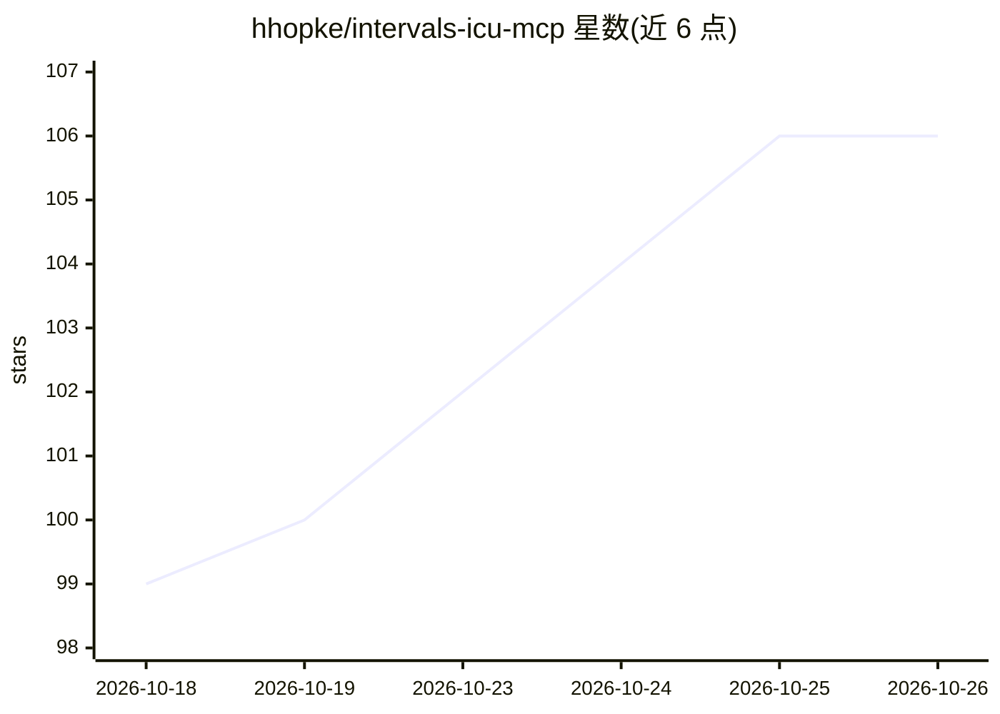

# hhopke/intervals-icu-mcp

⭐ 106 · Python · MIT · 推送 2026-10-25 · [GitHub](https://github.com/hhopke/intervals-icu-mcp) · 个人维护

**通过 Claude/ChatGPT 等读写 Intervals.icu 训练数据的 MCP 服务器**

面向 Intervals.icu 的 Model Context Protocol 服务器，把训练数据读写能力暴露给 LLM 客户端（Claude Desktop、Claude Code、Cursor、ChatGPT）。提供 69 个工具（活动、分析、运动员档案、健康指标、事件日历、功率曲线、训练库、装备、分区设置等）、4 个资源与 9 个提示模板。默认 stdio 传输，支持 HTTP/SSE 远程部署与 Docker；删除类工具受服务端 DELETE_MODE 环境变量门控。基于 uv/uvx 安装，需要 Intervals.icu API Key 与运动员 ID。

## 筛选速览

| 维度 | 判定 | 备注 |
|---|---|---|
| AI 角色 | `ai-ecosystem` | LLM/agent 周边工具 |
| 许可风险 | `permissive` | MIT |
| 部署形态 | `self-host` | docker 或自建部署 |
| 模型依赖 | — | README 未给出锁定关系 |
| 硬件要求 | — | 无带数字的原话,不猜 |
| 安装摩擦 | `low` | 无编译、无系统依赖或容器化 |
| 成熟度 | — | 结构信号不足 |

## 能力要点

- 69 个工具覆盖活动、健康、日历、训练库、装备等 12 类数据读写
- 支持 Claude Desktop / Claude Code / Cursor / ChatGPT 多客户端配置
- 删除安全模式：destructive 工具由服务端环境变量门控
- 支持 stdio / HTTP / SSE 三种传输与 Docker 部署

## 适用场景

- 用自然语言向 Claude 查询近 30 天训练活动与 CTL/ATL/TSB
- 让 LLM 读取 HRV 与睡眠数据评估恢复状态
- 通过对话生成结构化训练课表并写入日历

## 场景标签

`数据分析` · 领域:效率与自动化

## 证据(README 行号)

> L5: A Model Context Protocol (MCP) server for Intervals.icu integration. Access your training data, wellness metrics, an
> L17: 69 tools spanning activities, activity analysis, activity messages, athlete profile, wellness, events/calendar, per

## 星数曲线

2026-10-18 99 → 2026-10-26 106（+7）

---
*卡片 v1 · prompt 1.4 · 生成 2026-10-23 · 置信度 high · 依据 README sha `56ca0b02da87` · [字段定义](../../DATASET.md)*
