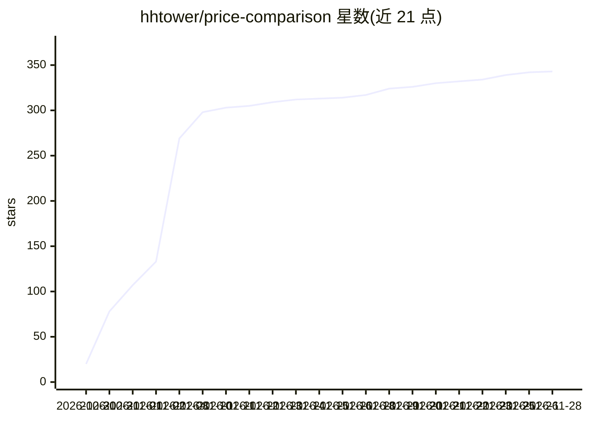

# hhtower/price-comparison

⭐ 343 · TypeScript · GPL-3.0 · 推送 2026-11-27 · [GitHub](https://github.com/hhtower/price-comparison) · [官网](https://price.yufu.pub) · 个人维护 · 中文 README

**AI 订阅与账号卡网比价平台，对话式帮选报价**

自托管的订阅与账号比价平台：聚合卡网/发卡站的 ChatGPT/Codex、Claude、Gemini、Grok、Cursor 等报价，覆盖代充、成品号、共享账号、兑换码及邮箱、接码等配套服务，支持跨商铺比价、价格走势与质保条件筛选。提供 AI 导购助手（对话筛选、比较商家报价），并通过 Skill/MCP 将报价数据接入用户自己的 AI 客户端。需 PostgreSQL 16+ 与 Redis 7+，AI 默认关闭，启用后向配置的模型服务发送数据并可能产生费用。

## 筛选速览

| 维度 | 判定 | 备注 |
|---|---|---|
| AI 角色 | `ai-enhanced` | 去掉 AI 部分产品仍成立 |
| 许可风险 | `viral` | GPL-3.0 |
| 部署形态 | `None` |  |
| 模型依赖 | — | README 未给出锁定关系 |
| 硬件要求 | — | 无带数字的原话,不猜 |
| 安装摩擦 | `low` | 无编译、无系统依赖或容器化 |
| 成熟度 | — | 结构信号不足 |

## 能力要点

- AI 导购助手：说出需求与预算，筛选并比较站内商家报价
- Skill/MCP 接入：让自有 AI 工具完成商品搜索、比价与价格历史查询，返回保留来源链接与采集时间
- 聚合代充、成品号、共享账号、兑换码等多类商品，支持价格走势与官方地区价参考
- 提供 Docker 与 npm 两种部署方式

## 适用场景

- 对比多家卡网的 ChatGPT Plus / Claude 代充报价与质保条件
- 追踪订阅账号价格走势，选择合适的充值渠道
- 通过 MCP 在自己的 AI 助手里直接查询商品报价
- 搭建自己的比价工具与自动化工作流

## 场景标签

`网页抓取` · 领域:效率与自动化

## 证据(README 行号)

> L11: 知途 · 拾价是以 **AI 导购助手与 Skill / MCP 报价接入**为核心的订阅与账号比价平台。站内用对话筛选、比较商品，站外通过 Skill 或 MCP 将报价接入你自己的 AI 客户端与工作流。
> L56: 开发模式运行 `npm run dev`，访问终端显示的前端地址。配置项见 .env.example，worker 与导购的启用方式见 开发与部署。AI 默认关闭，启用后会向配置的模型服务发送相关商品资料或对话需求，并可能产生费用

## 星数曲线

2026-10-30 20 → 2026-11-28 343（+323）

---
*卡片 v1 · prompt 1.4 · 生成 2026-11-25 · 置信度 mid · 依据 README sha `4b3346e358dc` · [字段定义](../../DATASET.md)*
