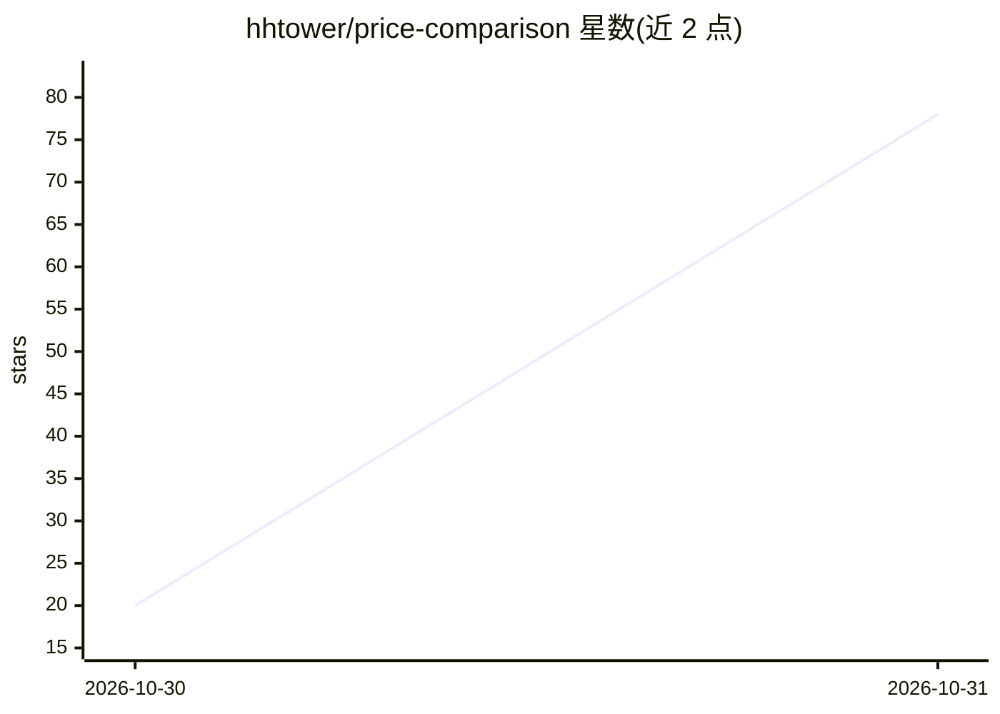

# hhtower/price-comparison

⭐ 78 · TypeScript · GPL-3.0 · 推送 2026-10-30 · [GitHub](https://github.com/hhtower/price-comparison) · [官网](https://price.yufu.pub) · 个人维护 · 中文 README

**自部署的 AI 商品比价站：采集、归类与跨商铺价格比较**

面向自托管用户的商品比价平台：自动采集商铺商品，AI 流程依次进行身份识别、独立复核与标准化归类，并提取/复核购买属性标签，汇总到统一目录实现跨商铺比价，附带价格历史与管理后台（/admin）。技术栈为 React、NestJS/Fastify、PostgreSQL 16+ 与 Redis 7+。提供 npm 编译运行与 Docker Compose 两种部署方式；AI 默认关闭，启用后会向配置的模型服务发送商品证据并可能产生费用，模型服务需自行配置。

## 筛选速览

| 维度 | 判定 | 备注 |
|---|---|---|
| AI 角色 | `ai-native` | 本体是模型或模型工具 |
| 许可风险 | `viral` | GPL-3.0 |
| 部署形态 | `None` |  |
| 模型依赖 | — | README 未给出锁定关系 |
| 硬件要求 | — | 无带数字的原话,不猜 |
| 安装摩擦 | `low` | 无编译、无系统依赖或容器化 |
| 成熟度 | — | 结构信号不足 |

## 能力要点

- 商铺采集 + AI 身份识别、独立复核与标准化归类的自动处理管线
- 购买属性标签的提取与复核，汇总统一目录跨商铺比价
- 价格历史与管理后台（/admin，含商铺添加与审核）
- npm 编译运行与 Docker Compose 两种部署途径

## 适用场景

- 自建跨商铺的商品比价站点并跟踪价格历史
- 在管理后台添加审核商铺并自动采集归类商品
- 基于统一商品目录比较不同商铺的报价

## 场景标签

`网页抓取` · 领域:效率与自动化

## 证据(README 行号)

> L7: 一个自部署的 AI 商品比价站，支持商铺采集、报价比较、标准商品归类、价格历史和管理后台。使用 React、NestJS / Fastify、PostgreSQL 和 Redis；AI 自动化流程将采集后的商品依次进行身份识别、独立
> L30: 开发模式运行 `npm run dev`，访问终端显示的前端地址。配置项见 .env.example，worker 和部署说明见 WORKFLOW.md。AI 默认关闭，启用后会向配置的模型服务发送商品证据并可能产生费用。

## 星数曲线

2026-10-30 20 → 2026-10-31 78（+58）

---
*卡片 v1 · prompt 1.4 · 生成 2026-10-30 · 置信度 mid · 依据 README sha `d718abb3ee51` · [字段定义](../../DATASET.md)*
