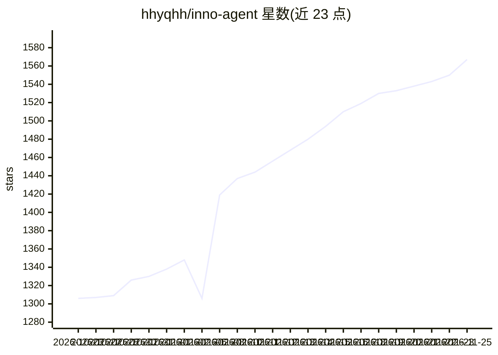

# hhyqhh/inno-agent

⭐ 1,567 · TypeScript · MIT · 推送 2026-11-22 · [GitHub](https://github.com/hhyqhh/inno-agent) · [官网](https://hhyqhh.github.io/inno-agent-website) · 个人维护 · 中文 README

**个人学习 agent：分层记忆+主动调度+IM 通道**

基于 Pi coding-agent SDK（不修改内核）构建的单用户学习陪伴 agent，将学习支持组织为三层显式记忆：L1 学习者画像、L2 wiki 知识库（BM25+知识图混合检索、文档摄取）、L3 基于 SQLite FTS5 的跨会话检索，并配 cron 调度器、飞书/微信个人 IM 通道和带浏览器终端的 Practice Lab。刻意不做多用户并发与横向扩容，无认证模型，团队场景需每人一个实例。以桌面应用（Electron）、Web UI、终端 CLI 三种形态交付，共享运行时状态。

## 筛选速览

| 维度 | 判定 | 备注 |
|---|---|---|
| AI 角色 | `ai-native` | 本体是模型或模型工具 |
| 许可风险 | `permissive` | MIT |
| 部署形态 | `desktop` | 安装包/桌面程序 |
| 模型依赖 | local-ok | 支持本地模型 |
| 硬件要求 | — | 无带数字的原话,不猜 |
| 安装摩擦 | `low` | 无编译、无系统依赖或容器化 |
| 成熟度 | — | 结构信号不足 |

## 能力要点

- 三层记忆：学习者画像、wiki 知识库（BM25+知识图）、SQLite FTS5 跨会话检索
- 自然语言创建 cron 任务的主动调度器
- 飞书原生 + 微信/QQ bridge 个人 IM 通道
- 可选 OS 级沙箱与桌面端 computer use（默认关闭）

## 适用场景

- 作为长期学习伙伴记录我的知识状态并跨会话跟进
- 通过微信/飞书接收学习提醒并直接对话
- 在 Practice Lab 终端里做练习并让 agent 读取运行记录
- 一键使用预设工作区（教案/PPT/情景讲解）

## 场景标签

`Agent 记忆` `知识库管理` `AI 助手` · 领域:Agent 开发

## 证据(README 行号)

> L18: Inno Agent is a single-learner companion that organizes long-term learning support into three explicit memory layer
> L28: General-purpose coding agents optimize for open-ended software engineering. Education is a different target: the va
> L57: - 🔌 **Pluggable providers** — any `openai-completions` or `anthropic-messages` endpoint (Anthropic, OpenAI, DeepSee

## 星数曲线

2026-10-23 1,306 → 2026-11-25 1,567（+261）

---
*卡片 v1 · prompt 1.4 · 生成 2026-11-23 · 置信度 high · 依据 README sha `69d644090034` · [字段定义](../../DATASET.md)*
