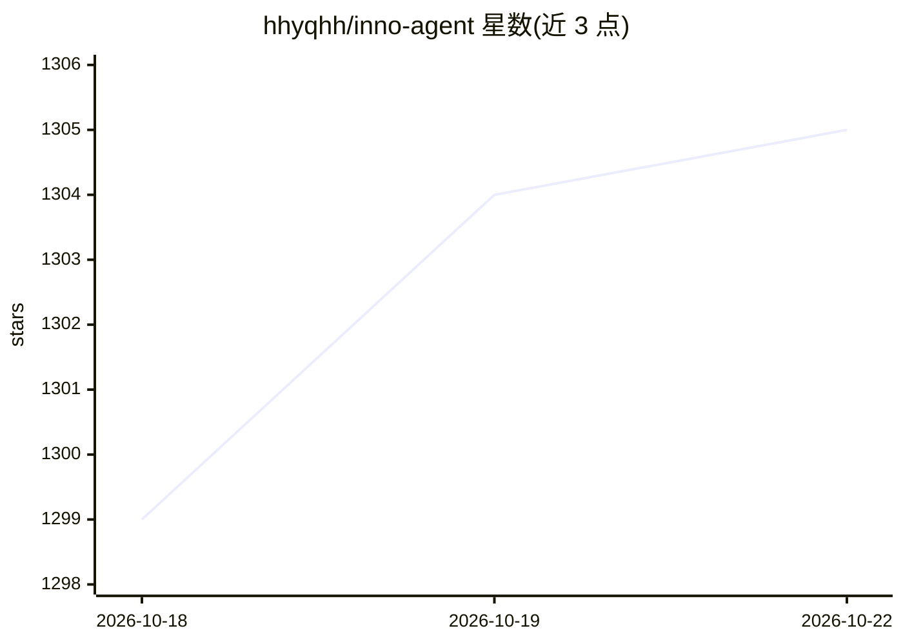

# hhyqhh/inno-agent

⭐ 1,306 · TypeScript · MIT · 推送 2026-10-21 · [GitHub](https://github.com/hhyqhh/inno-agent) · [官网](https://hhyqhh.github.io/inno-agent-website) · 个人维护 · 中文 README

**单人学习伴侣 agent：三层记忆+主动调度+个人 IM 通道**

基于 Pi coding-agent SDK 的开源个人学习 agent，不修改其内核，通过注册工具与一个扩展钩子添加学习行为。记忆分三层：L1 学习者画像（可检查可编辑）、L2 原生 wiki 知识库（BM25+知识图谱混合检索、PDF/Office/图片摄取）、L3 基于 SQLite FTS5 的跨会话召回。另含自然语言创建的 cron 主动调度器、飞书/微信/QQ 个人 IM 通道、带网页终端的 Practice Lab。以桌面应用（Electron）、Web UI、CLI 三种形态交付，明确声明单进程单会话、无多用户并发与水平扩展。提供商可插拔（openai-completions/anthropic-messages 端点，含 Anthropic/OpenAI/DeepSeek/Ollama/本地模型）。

## 筛选速览

| 维度 | 判定 | 备注 |
|---|---|---|
| AI 角色 | `ai-native` | 本体是模型或模型工具 |
| 许可风险 | `permissive` | MIT |
| 部署形态 | `desktop` | 安装包/桌面程序 |
| 模型依赖 | — | README 未给出锁定关系 |
| 硬件要求 | — | 无带数字的原话,不猜 |
| 安装摩擦 | `low` | 无编译、无系统依赖或容器化 |
| 成熟度 | — | 结构信号不足 |

## 能力要点

- L1 画像/L2 wiki/L3 会话召回三层记忆，个性化证据驱动可追溯
- cron 主动调度器与飞书/微信/QQ 个人 IM 通道
- 桌面（Electron）/Web UI/CLI 三形态共享同一运行时状态
- 权限层（allow/ask/deny 三模式）+ 可选 OS 级沙箱（pi-sandbox）
- 桌面端 GUI computer use（辅助功能树优先，副作用动作需审批）

## 适用场景

- 长期跟学：让 agent 记住我的目标、知识状态与误区并调度复习
- 把学习资料摄取进 wiki 知识库并混合检索
- 通过飞书/微信接收提醒与练习，在 Practice Lab 里跑代码
- 面向非技术用户用 Simple Mode 一键使用预设工作区

## 场景标签

`AI 助手` `知识库管理` · 领域:对话与助手

## 证据(README 行号)

> L3: > An open-source **personal learning agent** with layered memory, a proactive scheduler, multi-channel messaging, an
> L18: Inno Agent is a single-learner companion that organizes long-term learning support into three explicit memory layer
> L57: - 🔌 **Pluggable providers** — any `openai-completions` or `anthropic-messages` endpoint (Anthropic, OpenAI, DeepSee

## 星数曲线

2026-10-18 1,299 → 2026-10-22 1,305（+6）

---
*卡片 v1 · prompt 1.4 · 生成 2026-10-21 · 置信度 high · 依据 README sha `6487855f7c3e` · [字段定义](../../DATASET.md)*
