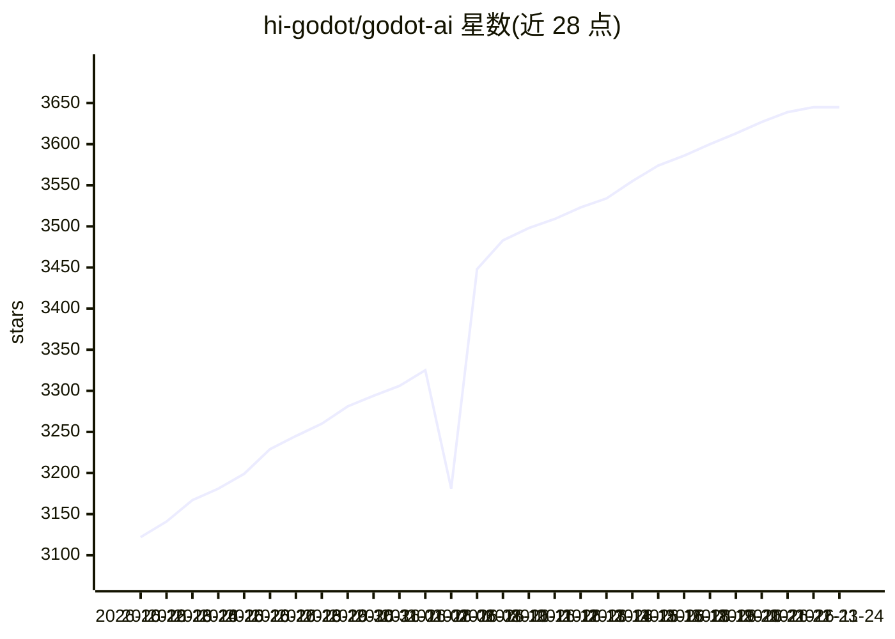

# hi-godot/godot-ai

⭐ 3,645 · GDScript · MIT · 推送 2026-11-22 · [GitHub](https://github.com/hi-godot/godot-ai) · 组织维护

**将 MCP 客户端接入 Godot 编辑器的 MCP 服务器与工具集**

以 Godot 编辑器插件加 Python MCP 服务器的形式，连接 Claude Code、Codex、Cursor 等 MCP 客户端到运行中的 Godot 编辑器，提供 46 个工具与 120+ 操作，用于构建场景、编辑节点与脚本、连接信号、配置 UI/材质/动画/粒子/相机/环境。编辑器内 dock 可一键配置 26 个客户端，v4 客户端经 `godot-ai attach` 以 stdio 接入，本地链路采用轮换凭据认证且仅限回环连接。GDScript 完整支持（含解析校验与热重载），C# 仅限文本写入，不构建 .NET。需 Godot 4.7+ 与 uv。

## 筛选速览

| 维度 | 判定 | 备注 |
|---|---|---|
| AI 角色 | `ai-ecosystem` | LLM/agent 周边工具 |
| 许可风险 | `permissive` | MIT |
| 部署形态 | `None` |  |
| 模型依赖 | — | README 未给出锁定关系 |
| 硬件要求 | — | 无带数字的原话,不猜 |
| 安装摩擦 | `low` | 无编译、无系统依赖或容器化 |
| 成熟度 | — | 结构信号不足 |

## 能力要点

- 46 个工具、120+ 操作，覆盖场景/节点/信号/UI/材质/动画等编辑操作
- 编辑器 dock 一键配置 26 个 MCP 客户端
- 签名发布、轮换凭据认证、回环限制与项目目录写入限制等安全机制
- GDScript 支持解析校验与热重载；C# 仅文本写入

## 适用场景

- 在 Godot 编辑器中通过 Claude Code 等客户端对话式构建与修改场景
- 为游戏项目编写并运行场景测试
- 用提示词从零搭建小型游戏原型

## 场景标签

`编码 Agent` `代码生成` · 领域:编码与开发

## 证据(README 行号)

> L9: **Godot AI connects Claude Code, Codex, Cursor, and other
> L11: editor.** Its 46 tools and 120+ operations build scenes, edit
> L130:   → Python server (authenticated HTTP, port 8000)

## 星数曲线

2026-10-22 3,122 → 2026-11-24 3,645（+523）

---
*卡片 v1 · prompt 1.4 · 生成 2026-11-23 · 置信度 high · 依据 README sha `bcebbbde340f` · [字段定义](../../DATASET.md)*
