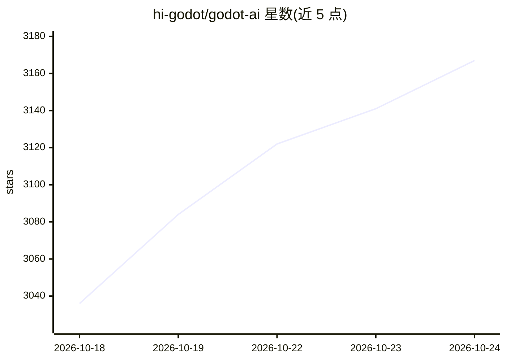

# hi-godot/godot-ai

⭐ 3,181 · GDScript · MIT · 推送 2026-10-24 · [GitHub](https://github.com/hi-godot/godot-ai) · 个人维护

**把 MCP 客户端接入 Godot 编辑器的 MCP 服务器与工具集**

面向 Godot 4.7+（4.x 线）的编辑器插件加 Python MCP 服务器，通过 stdio 的 godot-ai attach 与认证 HTTP/WebSocket 两级本地链路，将 Claude Code、Claude Desktop、Codex、Cursor 等 MCP 客户端连接到运行中的 Godot 编辑器。提供 46 个工具与 120+ 操作，供 AI 助手构建场景、编辑节点与脚本、连接信号、配置 UI、材质、动画、粒子、相机和环境。GDScript 全支持；C# 为仅文本写入，不做 .NET 构建与编译错误报告。安装依赖 uv/uvx 提供 Python 服务端。

## 筛选速览

| 维度 | 判定 | 备注 |
|---|---|---|
| AI 角色 | `ai-ecosystem` | LLM/agent 周边工具 |
| 许可风险 | `permissive` | MIT |
| 部署形态 | `None` |  |
| 模型依赖 | — | README 未给出锁定关系 |
| 硬件要求 | — | 无带数字的原话,不猜 |
| 安装摩擦 | `medium` | 含编译或系统依赖之一 |
| 成熟度 | — | 结构信号不足 |

## 能力要点

- 46 个工具、120+ 操作覆盖场景/节点/脚本/UI/材质/动画等编辑能力
- MCP 客户端（Claude Code、Claude Desktop、Codex、Cursor、VS Code 等）一键配置接入
- 两跳本地链路均使用轮换能力认证，WebSocket 仅限回环地址
- 遥测仅记录 UUID、事件、时长、平台与版本，可环境变量关闭

## 适用场景

- 让 AI 助手在 Godot 编辑器里直接搭建场景与编写 GDScript
- 通过对话查询场景层级、搜索资源、运行场景测试
- 用少量提示词构建带存档系统的小型游戏原型

## 场景标签

`编码 Agent` · 领域:编码与开发

## 证据(README 行号)

> L9: **Godot AI connects Claude Code, Claude Desktop, Codex, Hermes Agent, and other
> L10: MCP clients to a live Godot
> L11: editor.** Its 46 tools and 120+ operations let AI assistants

## 星数曲线

2026-10-18 3,036 → 2026-10-24 3,167（+131）

---
*卡片 v1 · prompt 1.4 · 生成 2026-10-20 · 置信度 high · 依据 README sha `ee70126da0b2` · [字段定义](../../DATASET.md)*
