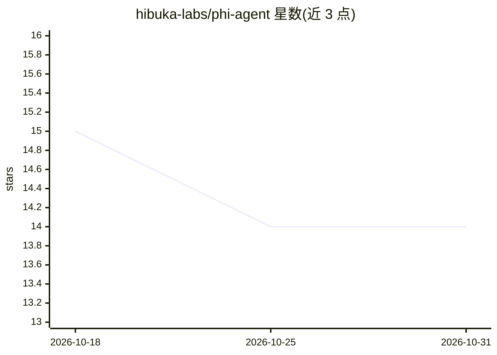

# hibuka-labs/phi-agent

⭐ 14 · Rust · MIT · 推送 2026-10-24 · [GitHub](https://github.com/hibuka-labs/phi-agent) · [官网](https://docs.phiagent.dev) · 组织维护

**Rust AI Agent 运行时框架：自带编排/会话/流式，工具由用户定义**

以三个 crate 组成的 Rust AI Agent 框架：agent-base 提供运行时内核（LLM 客户端、Tool trait、事件流），agent-works 提供 MCP/Skills 等工具箱，phi-agent 提供完整框架与 CLI。产品本身不携带任何应用工具（无搜索/数据库/代码执行），文件 I/O、shell、子代理等内核工具经 feature flags 按需启用，file 与 MCP 默认开启。每次 LLM 调用与工具执行记录为 JSONL，会话可快照。经 cargo 安装为单一二进制，含 REPL 模式。

## 筛选速览

| 维度 | 判定 | 备注 |
|---|---|---|
| AI 角色 | `ai-ecosystem` | LLM/agent 周边工具 |
| 许可风险 | `permissive` | MIT |
| 部署形态 | `library` | 以包/库形式分发 |
| 模型依赖 | — | README 未给出锁定关系 |
| 硬件要求 | — | 无带数字的原话,不猜 |
| 安装摩擦 | `low` | 无编译、无系统依赖或容器化 |
| 成熟度 | — | 结构信号不足 |

## 能力要点

- 三 crate 生态：agent-base 内核 / agent-works 工具箱 / phi-agent 完整框架
- 零应用工具设计，内核工具经 feature flags 按需启用（file、MCP 默认开启）
- MCP 协议支持与多代理编排（multi-agent 为 opt-in）
- 全步骤 JSONL 审计记录与会话快照

## 适用场景

- 在 Rust 项目中构建自带工具集的 LLM Agent
- 需要可审计、可回放会话的 agent 部署
- 通过 CLI/REPL 快速运行单二进制 agent

## 场景标签

`Agent 框架` · 领域:Agent 开发

## 证据(README 行号)

> L13: Rust AI Agent runtime framework — orchestration, sessions, streaming all built-in. You only define tools, prompts, 
> L15: > **phi-agent ships with zero application tools.** No web search, no database connector, no code executor — just a 
> L23: |`agent-base`|Crates.io|Lightweight runtime kernel — LLM clients, Tool trait, event stream|

## 星数曲线

2026-10-18 15 → 2026-10-31 14（-1）

---
*卡片 v1 · prompt 1.4 · 生成 2026-10-31 · 置信度 mid · 依据 README sha `da1588e7ec01` · [字段定义](../../DATASET.md)*
