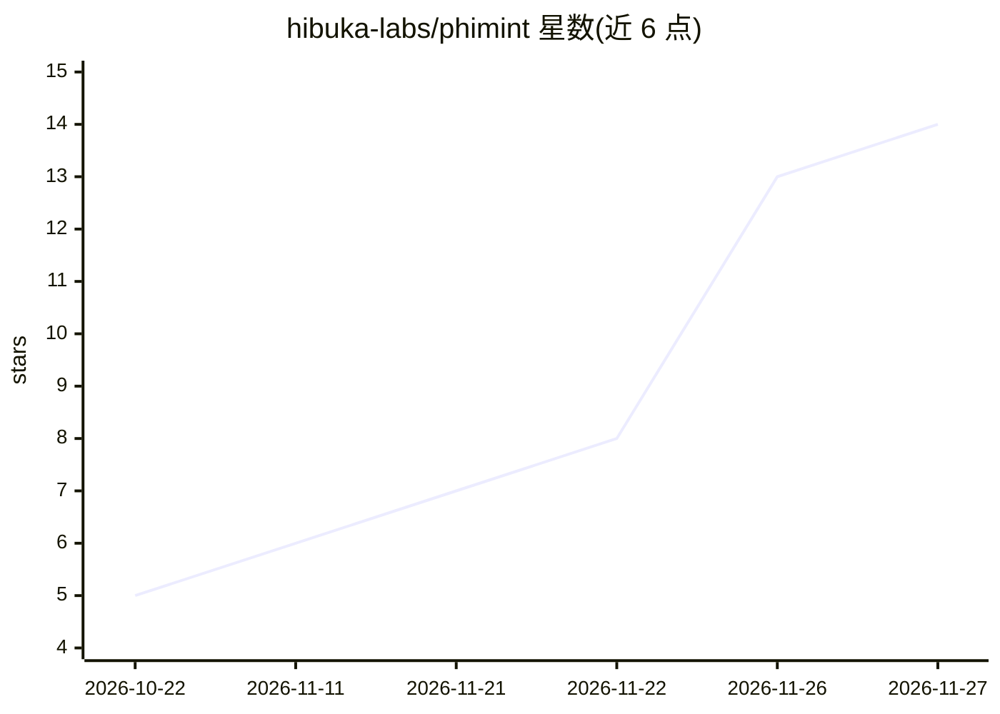

# hibuka-labs/phimint

⭐ 14 · Rust · Apache-2.0 · 推送 2026-11-23 · [GitHub](https://github.com/hibuka-labs/phimint) · [官网](https://hibuka-labs.github.io/phimint/) · 组织维护 · 中文 README

**终端 AI 编码 agent：读码改码编译测试的全流程循环**

基于 Rust 与 phi-agent 框架构建的终端 AI 编码 agent，以 ratatui 流式 TUI 交付。运行完整编码循环：理解请求、读取代码、修改多文件、编译测试并迭代修复。机制包括常驻 Python 会话的 code cells、tree-sitter+ripgrep 的按需仓库上下文、LSP 快速内循环（rust-analyzer/tsserver/clangd）、多 agent fan-out 与三级审批模式（auto/ask/deny）。MIT 许可，提供 macOS/Linux/Windows 预编译二进制，无需 Rust 工具链即可安装；需配置 API key。

## 筛选速览

| 维度 | 判定 | 备注 |
|---|---|---|
| AI 角色 | `ai-native` | 本体是模型或模型工具 |
| 许可风险 | `permissive` | Apache-2.0 |
| 部署形态 | `library` | 以包/库形式分发 |
| 模型依赖 | local-ok | 支持本地模型 |
| 硬件要求 | — | 无带数字的原话,不猜 |
| 安装摩擦 | `low` | 无编译、无系统依赖或容器化 |
| 成熟度 | — | 结构信号不足 |

## 能力要点

- spawn_agent 多子代理 fan-out，主代理在回合末收取完整报告，默认只读
- LSP 快速内循环：秒级获得 file:line:col 诊断，缺失时回退 shell
- pull-based 上下文：repo_map（tree-sitter）+ ripgrep 按需搜索，不整仓塞入上下文
- 三级模型分层（main/lite/advanced）与 /model 选择指针机制

## 适用场景

- 在终端里让 agent 完成多文件修改并跑通编译测试
- 通过子代理并行调查大型代码库的多个问题
- 用自有工具/WIT 插件/MCP 服务器扩展 agent 能力

## 场景标签

`编码 Agent` `多智能体` · 领域:Agent 开发

## 证据(README 行号)

> L3: **Pronounced** `/ˈfaɪmɪnt/` ("fie-mint", phi + mint) — a terminal AI coding agent built on phi-agent, the agent runt
> L13: phimint runs the full coding loop — understand the request, read the code, change multiple files, compile and test,
> L24: - **LSP fast inner loop** — lazily started per-language servers (rust-analyzer, typescript-language-server, clangd)

## 星数曲线

2026-10-22 5 → 2026-11-27 14（+9）

---
*卡片 v1 · prompt 1.4 · 生成 2026-11-20 · 置信度 high · 依据 README sha `f3b3cee9dab7` · [字段定义](../../DATASET.md)*
