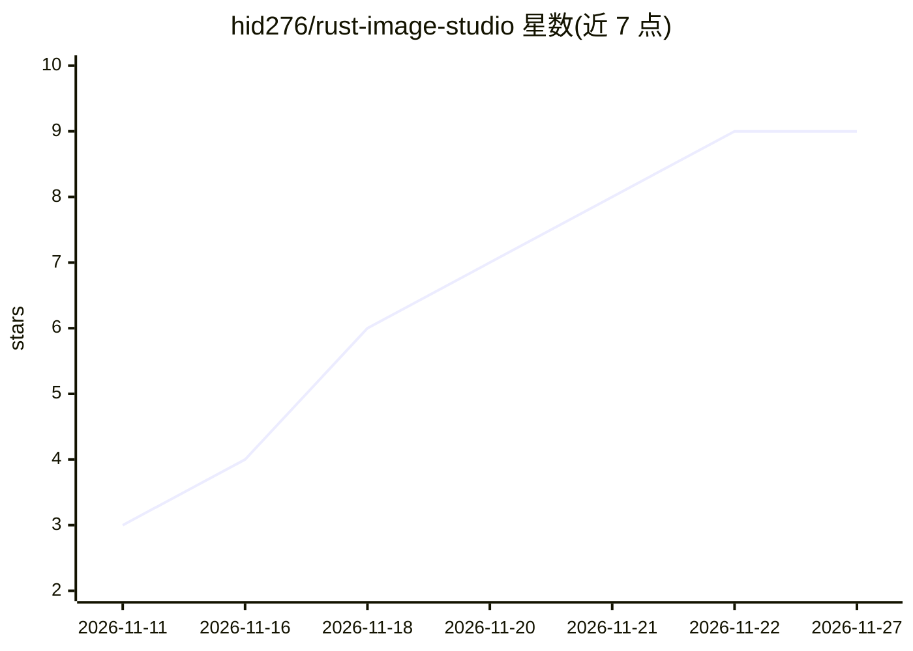

# hid276/rust-image-studio

⭐ 9 · Rust · MIT · 推送 2026-11-12 · [GitHub](https://github.com/hid276/rust-image-studio) · 个人维护

**给创作者和开发者的本地离线 AI 图像生成桌面应用**

以 Rust 原生实现的桌面图像工作室，基于 Qwen-Image-2.1 Turbo 模型在本地离线推理，提供文生图、img2img 变体、指令编辑、inpainting 与保真 outpainting 五种模式。通过固定 6 GB VRAM 预算、常驻预热模型和可选 INT8 路径在 8 GB 显卡上实现流畅生成，4–6 GB 显卡自动切换低显存模式。首启自动配置引擎（stable-diffusion.cpp）与模型，单一可执行文件无需 Python 或 ComfyUI。AMD Radeon 为实验性支持。

## 筛选速览

| 维度 | 判定 | 备注 |
|---|---|---|
| AI 角色 | `ai-native` | 本体是模型或模型工具 |
| 许可风险 | `permissive` | MIT |
| 部署形态 | `desktop` | 安装包/桌面程序 |
| 模型依赖 | — | README 未给出锁定关系 |
| 硬件要求 | — | 无带数字的原话,不猜 |
| 安装摩擦 | `high` | 编译与系统依赖俱全 |
| 成熟度 | — | 结构信号不足 |

## 能力要点

- 本地离线推理，无需账号、订阅或云端服务
- 1024×1024 在 RTX 3060 Ti 8 GB 上约 10–19 秒，4–6 GB 显卡自动低显存模式
- 五种模式：文生图、变体、指令编辑（最多 3 张参考图）、inpaint、outpaint
- 内置 LoRA 一键下载与 PNG 嵌入种子/参数的智能画廊

## 适用场景

- 在没有高端 GPU 且不能联网的环境下本地生成图像
- 替换产品照片中的局部（如手机壳设计）并保留人物姿态
- 拖拽画布边缘做保真扩图与多方向视角变体

## 场景标签

`图像生成` · 领域:内容生成

## 证据(README 行号)

> L5: **Run Qwen-Image-2.1 locally · an on-device AI image studio built natively in Rust**
> L6: Text-to-image · img2img variation · instruction editing · inpainting · *fidelity-preserving outpainting*
> L110: **System requirements:** Windows 10/11 x64 · NVIDIA GPU with **8 GB+ VRAM** recommended, 4–6 GB works in an automa

## 星数曲线

2026-11-11 3 → 2026-11-27 9（+6）

---
*卡片 v1 · prompt 1.4 · 生成 2026-11-20 · 置信度 high · 依据 README sha `569f0a904211` · [字段定义](../../DATASET.md)*
