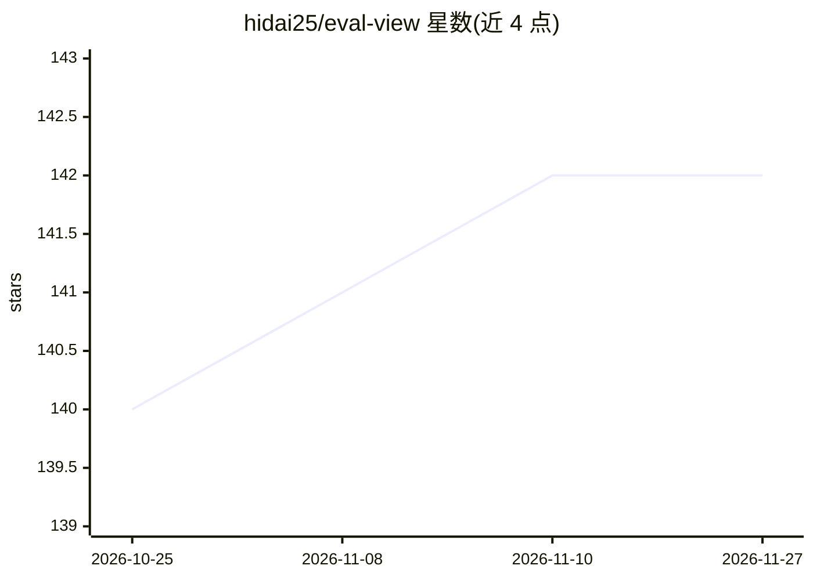

# hidai25/eval-view

⭐ 142 · Python · Apache-2.0 · 推送 2026-11-20 · [GitHub](https://github.com/hidai25/eval-view) · [官网](https://evalview.com)

**AI agent 行为快照回归测试工具：CI 中捕获回归**

面向构建 AI agent 的开发者，提供快照式回归测试：用 snapshot 记录 agent 当前的工具调用轨迹（名称、参数、顺序），check 与基线做确定性 diff，无需 API key 即可离线运行；可选 LLM judge 做输出质量评分，嵌入语义比较为 opt-in。提供 pip 安装的 CLI 与 Python 库（gate API），支持 GitHub Actions 中作为 PR pass/fail 门禁并输出 diff 与成本/延迟变化。另含多轮测试、pass@k、record/replay、生产监控等功能。

## 筛选速览

| 维度 | 判定 | 备注 |
|---|---|---|
| AI 角色 | `ai-ecosystem` | LLM/agent 周边工具 |
| 许可风险 | `permissive` | Apache-2.0 |
| 部署形态 | `library` | 以包/库形式分发 |
| 模型依赖 | — | README 未给出锁定关系 |
| 硬件要求 | — | 无带数字的原话,不猜 |
| 安装摩擦 | `low` | 无编译、无系统依赖或容器化 |
| 成熟度 | — | 结构信号不足 |

## 能力要点

- 快照记录 agent 完整工具调用轨迹并与基线 diff
- 确定性工具+顺序 diff 离线运行，无需 API key
- CI 集成输出 diff、成本/延迟增量与 pass/fail 门禁
- 支持多轮测试、pass@k、record/replay 与生产监控

## 适用场景

- 在 CI 中拦截 agent 行为漂移的 PR
- 模型或供应商变更后检测 agent 工具调用变化
- 对 prompt 修改做回归验证

## 场景标签

`模型评测` · 领域:评测与运维

## 证据(README 行号)

> L16: **EvalView snapshots your agent's behavior — the tools it calls, in what order, with what output — and tells you th
> L46: It diffs the **whole trajectory** — tool names, parameters, and order — not just the final string. The deterministi
> L102: ## CI: block regressions in every PR

## 星数曲线

2026-10-25 140 → 2026-11-27 142（+2）

---
*卡片 v1 · prompt 1.4 · 生成 2026-11-27 · 置信度 high · 依据 README sha `c3396680e6ef` · [字段定义](../../DATASET.md)*
