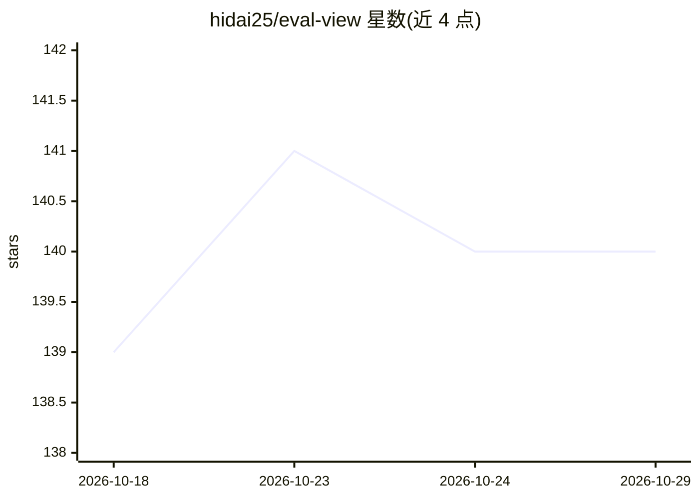

# hidai25/eval-view

⭐ 140 · Python · Apache-2.0 · 推送 2026-10-16 · [GitHub](https://github.com/hidai25/eval-view) · [官网](https://evalview.com) · 个人维护

**AI agent 行为快照回归测试工具，CI 中拦截行为漂移**

面向 AI agent 开发者的行为快照测试工具：以 `evalview snapshot` 录制 agent 当前行为基线（工具调用名、参数、顺序的完整轨迹），以 `evalview check` 对比差异并输出 PASSED/TOOLS_CHANGED/REGRESSION 三态结果，可在 PR 中作为回归门禁。确定性轨迹 diff 离线运行无需 API key，LLM judge 评分与嵌入语义对比为可选。声明兼容 LangGraph、CrewAI、OpenAI、Claude、Mistral、Ollama、MCP 及任意 HTTP API。另提供 Python 库接口、record/replay、多轮测试等扩展功能。已知限制：0.8.1 的 openai-assistants 适配器依赖已停用的 Assistants API，迁移版本未发布。

## 筛选速览

| 维度 | 判定 | 备注 |
|---|---|---|
| AI 角色 | `ai-ecosystem` | LLM/agent 周边工具 |
| 许可风险 | `permissive` | Apache-2.0 |
| 部署形态 | `library` | 以包/库形式分发 |
| 模型依赖 | local-ok | 支持本地模型 |
| 硬件要求 | — | 无带数字的原话,不猜 |
| 安装摩擦 | `low` | 无编译、无系统依赖或容器化 |
| 成熟度 | — | 结构信号不足 |

## 能力要点

- 快照/比对工作流记录并 diff 完整工具调用轨迹
- 确定性轨迹 diff 离线运行，无需 API key；LLM judge 为可选
- GitHub Actions 集成，PR 评论输出差异、成本/延迟变化与通过门禁
- 支持多轮测试、pass@k 统计、record/replay、模型漂移金丝雀与 Slack 告警

## 适用场景

- 模型或提示词更新后检查 agent 行为是否悄然改变
- 在 CI/PR 流程中为 agent 变更设置回归门禁
- 无需编写断言即可捕获未预期的行为漂移

## 场景标签

`模型评测` · 领域:评测与运维

## 证据(README 行号)

> L16: **EvalView snapshots your agent's behavior — the tools it calls, in what order, with what output — and tells you th
> L35: evalview snapshot    # Record your agent's current behavior as the baseline
> L36: evalview check       # After any change, diff against the baseline

## 星数曲线

2026-10-18 139 → 2026-10-29 140（+1）

---
*卡片 v1 · prompt 1.4 · 生成 2026-10-23 · 置信度 high · 依据 README sha `bdf97f5c2b51` · [字段定义](../../DATASET.md)*
