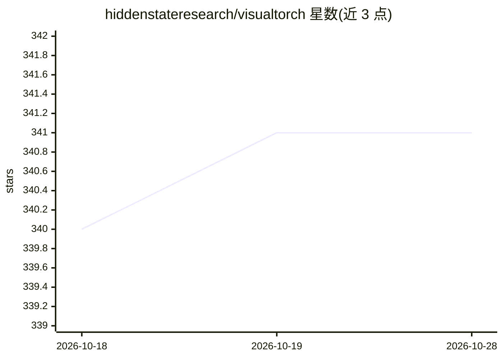

# hiddenstateresearch/visualtorch

⭐ 341 · Python · MIT · 推送 2026-10-27 · [GitHub](https://github.com/hiddenstateresearch/visualtorch) · [官网](https://visualtorch.readthedocs.io/en) · 组织维护

**PyTorch 神经网络架构可视化库：生成 flow/graph/lenet 风格图**

Python 库，面向使用 PyTorch 的开发者和科研人员，用于将 Torch 神经网络架构绘制为 flow、graph、lenet 三种风格的图，支持 Sequential 与自定义模型，通过追踪真实 forward pass 构建图示。1.0+ 版本有破坏性 API 变更。附带可选的 stdio MCP 服务器，可从 PyTorch 模型源码生成静态 PNG 与动画 GIF 逐层揭示，pip install "visualtorch[mcp]" 安装。已知限制：数据依赖控制流的模型只显示被追踪分支；多输出层的节点尺寸仅基于第一个张量（形状可在标签中完整显示）。已被 Nature、IEEE、MDPI 论文使用。

## 筛选速览

| 维度 | 判定 | 备注 |
|---|---|---|
| AI 角色 | `ai-ecosystem` | LLM/agent 周边工具 |
| 许可风险 | `permissive` | MIT |
| 部署形态 | `library` | 以包/库形式分发 |
| 模型依赖 | — | README 未给出锁定关系 |
| 硬件要求 | — | 无带数字的原话,不猜 |
| 安装摩擦 | `low` | 无编译、无系统依赖或容器化 |
| 成熟度 | — | 结构信号不足 |

## 能力要点

- 生成 flow/graph/lenet 三种风格的架构图
- visualtorch.animate 渲染逐层揭示的动画 GIF
- 可选 client 中立的 stdio MCP 服务器（PNG/GIF 生成）
- 追踪真实 forward pass，统一追踪后端

## 适用场景

- 论文或报告中展示 PyTorch 模型结构图
- 逐层动画演示模型的构建过程
- 通过 MCP 客户端以工具调用方式生成架构图

## 场景标签

 · 领域:深度学习工具/可视化

## 证据(README 行号)

> L5: **VisualTorch** aims to help visualize Torch-based neural network architectures. It currently supports generating fl
> L42: VisualTorch includes an optional, client-neutral stdio MCP server for generating static PNG

## 星数曲线

2026-10-18 340 → 2026-10-28 341（+1）

---
*卡片 v1 · prompt 1.4 · 生成 2026-10-21 · 置信度 high · 依据 README sha `181beeb1f32e` · [字段定义](../../DATASET.md)*
