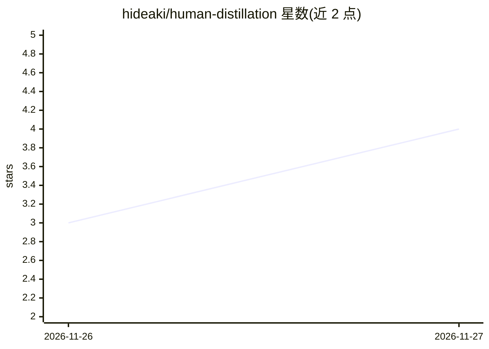

# hideaki/human-distillation

⭐ 4 · JavaScript · MIT · 推送 2026-11-25 · [GitHub](https://github.com/hideaki/human-distillation) · [官网](https://claude.ai/artifact/DT4Eotmtno3AZhJtxc7fA5) · 个人维护

**面向学习者的树状分支 AI 对话界面，可对答案任意部分追问**

以 Claude Artifact 形式实现的单 HTML 文件应用：普通对话之上加入树状分支机制，答案中的句子、公式、符号、图表框均可点击另开侧线程追问，全部分支保留；辅以悬停术语定义、公式排版（MathJax）、"讲回来"检查、Notion 检索与网页搜索连接器、跨对话答案导入和树状导图侧栏。运行无自建服务器、无 API key，回答使用查看者自己的 Claude 账户额度；会话存于浏览器 localStorage。发布自己的副本需 Claude Code 与构建脚本。

## 筛选速览

| 维度 | 判定 | 备注 |
|---|---|---|
| AI 角色 | `ai-native` | 本体是模型或模型工具 |
| 许可风险 | `permissive` | MIT |
| 部署形态 | `None` |  |
| 模型依赖 | locked-api |  |
| 硬件要求 | — | 无带数字的原话,不猜 |
| 安装摩擦 | `low` | 无编译、无系统依赖或容器化 |
| 成熟度 | `idea` | |

## 能力要点

- 树状对话：侧线程紧贴所问段落打开，分支全部保留
- 点击句子/高亮词/公式符号即可追问，无需打字
- 支持 Notion 只读检索与 Parallel Search 网页搜索连接器
- "Explain it back" 模式由 Claude 检查用户自己的复述

## 适用场景

- 学习难懂概念时对答案中的某个句子或公式符号单独追问
- 把别处 Claude 对话中的难题答案导入此页面逐部分研究
- 用"讲回来"让 AI 检查自己是否真正理解

## 场景标签

`聊天机器人` · 领域:对话与助手

## 证据(README 行号)

> L32: A prototype of an AI chat for understanding complex ideas, implemented as a Claude Artifact.
> L102: The app runs as a Claude artifact, and that is the one way to use it for
> L112: - `claude.use("sample")` asks Claude on the viewer's own account.

## 星数曲线

2026-11-26 3 → 2026-11-27 4（+1）

---
*卡片 v1 · prompt 1.4 · 生成 2026-11-26 · 置信度 high · 依据 README sha `3c7a25643c59` · [字段定义](../../DATASET.md)*
