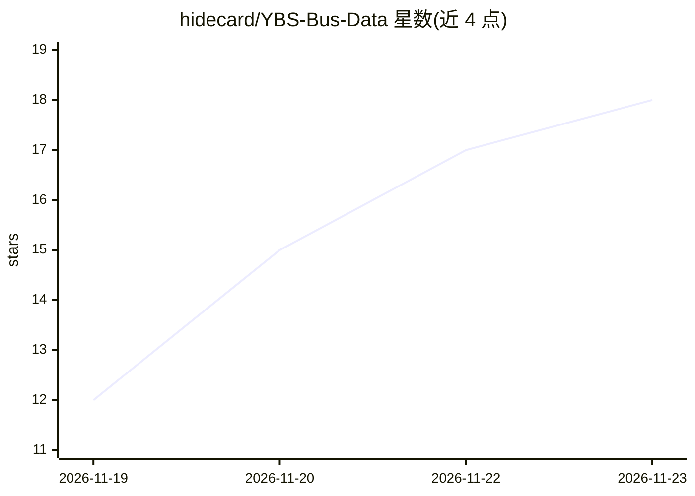

# hidecard/YBS-Bus-Data

⭐ 18 · 推送 2026-11-17 · [GitHub](https://github.com/hidecard/YBS-Bus-Data) · 个人维护

**仰光 YBS 公交线路与站点静态 JSON 开放数据集**

收录仰光 YBS 公交的线路、站点名称与坐标，以 147 个 JSON 文件加 api/routes.json 目录索引的形式发布；数据文件可通过 GitHub raw URL 直接 fetch，附 JavaScript、Python 与聊天机器人/AI 管道的接入示例代码。明确说明不含托管 API 服务器、实时车辆追踪或到站预测，建议生产环境自建缓存/backend，数据可能不完整或有误，使用前需自行核验。

## 筛选速览

| 维度 | 判定 | 备注 |
|---|---|---|
| AI 角色 | `ai-knowledge` | 知识聚合/清单类 |
| 许可风险 | `none` | — |
| 部署形态 | `None` |  |
| 模型依赖 | — | README 未给出锁定关系 |
| 硬件要求 | — | 无带数字的原话,不猜 |
| 安装摩擦 | `low` | 无编译、无系统依赖或容器化 |
| 成熟度 | — | 结构信号不足 |

## 能力要点

- 147 个线路 JSON 文件，含英/缅双语站名与经纬度坐标
- api/routes.json 作为目录索引，按 bus_line 查找 data_url
- 提供 Web/JS、Python/AI pipeline 与 bot 接入的示例代码
- 为 AI/聊天机器人给出五步接入模式并要求标注数据为静态

## 适用场景

- 给公交查询聊天机器人提供线路和站点数据
- 在地图或数据可视化中展示 YBS 公交网络
- 在 AI 助手中以静态数据回答公交路线问题

## 场景标签

 · 领域:交通/开放数据

## 证据(README 行号)

> L1: # YBS Bus Data (Yangon Bus Service)
> L5: > **သတိပြုရန်:** ဤ repository သည် static data files များပေးထားခြင်းသာဖြစ်ပြီး hosted API server, live bus tracking သ
> L9: - `ybs_*_data.json` — bus route တစ်ခုစီအတွက် JSON data (အောက်ပါ catalog တွင် လက်ရှိဖိုင် 147 ခုစာရင်းပြုထားသည်)

## 星数曲线

2026-11-19 12 → 2026-11-23 18（+6）

---
*卡片 v1 · prompt 1.4 · 生成 2026-11-19 · 置信度 high · 依据 README sha `02c330acaca7` · [字段定义](../../DATASET.md)*
