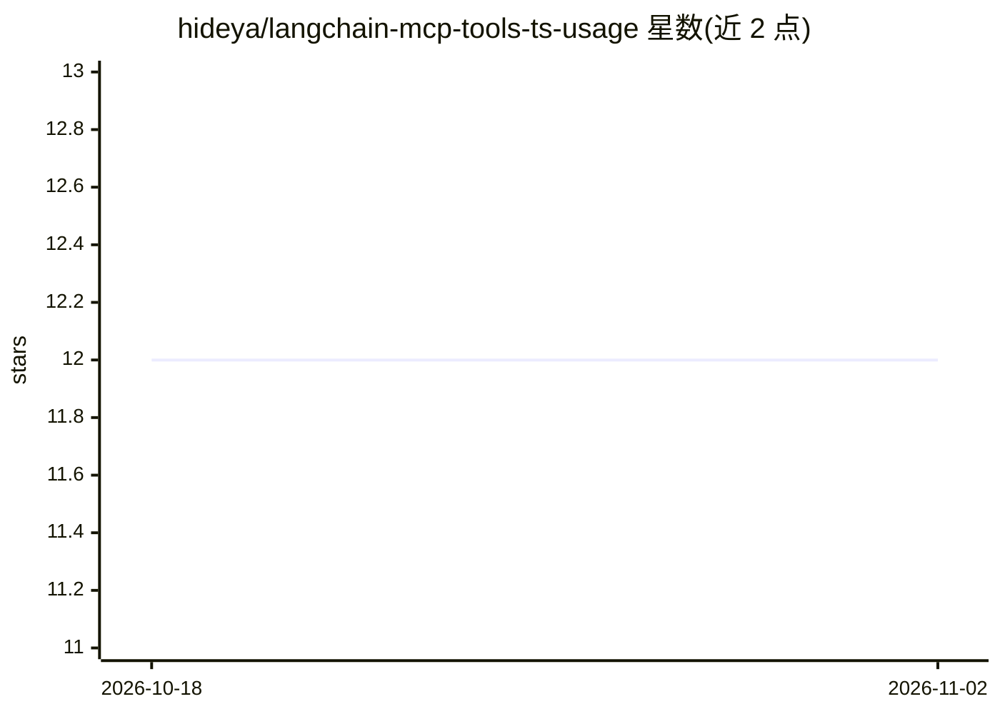

# hideya/langchain-mcp-tools-ts-usage

⭐ 12 · TypeScript · MIT · 推送 2026-03-28 · [GitHub](https://github.com/hideya/langchain-mcp-tools-ts-usage) · 个人维护

**TypeScript 示例：LangChain ReAct Agent 调用 MCP 工具**

一个基于 TypeScript 的 Model Context Protocol (MCP) 客户端示例，演示 LangChain ReAct Agent 如何使用 MCP 服务器的工具。核心依赖 @h1deya/langchain-mcp-tools 的 convertMcpToLangchainTools() 函数：并行初始化多个 MCP 服务器并将其工具转换为 LangChain 兼容的 StructuredTool[]，同时做 LLM 提供商特定的 schema 转换以避免兼容问题。默认使用 OpenAI 模型，附 Anthropic 等注释代码。运行需 Node.js 18+、npm 8+ 与相应 LLM API key。

## 筛选速览

| 维度 | 判定 | 备注 |
|---|---|---|
| AI 角色 | `ai-ecosystem` | LLM/agent 周边工具 |
| 许可风险 | `permissive` | MIT |
| 部署形态 | `library` | 以包/库形式分发 |
| 模型依赖 | — | README 未给出锁定关系 |
| 硬件要求 | — | 无带数字的原话,不猜 |
| 安装摩擦 | `low` | 无编译、无系统依赖或容器化 |
| 成熟度 | — | 结构信号不足 |

## 能力要点

- 演示 LangChain ReAct Agent 调用 MCP 服务器工具
- convertMcpToLangchainTools() 并行初始化多 MCP 服务器并转换工具
- LLM 提供商特定的 schema 转换以避免兼容问题
- 支持 OpenAI/Anthropic/Google GenAI/xAI 模型接入

## 适用场景

- 学习如何在 LangChain TypeScript 中接入 MCP 工具
- 参考构建带工具调用能力的 ReAct Agent 客户端
- 对比 OpenAI 与 Anthropic 模型的 MCP 工具用法

## 场景标签

`Agent 框架` · 领域:Agent 开发

## 证据(README 行号)

> L3: This simple Model Context Protocol (MCP)
> L6: It leverages a utility function `convertMcpToLangchainTools()` from

## 星数曲线

2026-10-18 12 → 2026-11-02 12（+0）

---
*卡片 v1 · prompt 1.4 · 生成 2026-11-01 · 置信度 high · 依据 README sha `619f82733f0a` · [字段定义](../../DATASET.md)*
